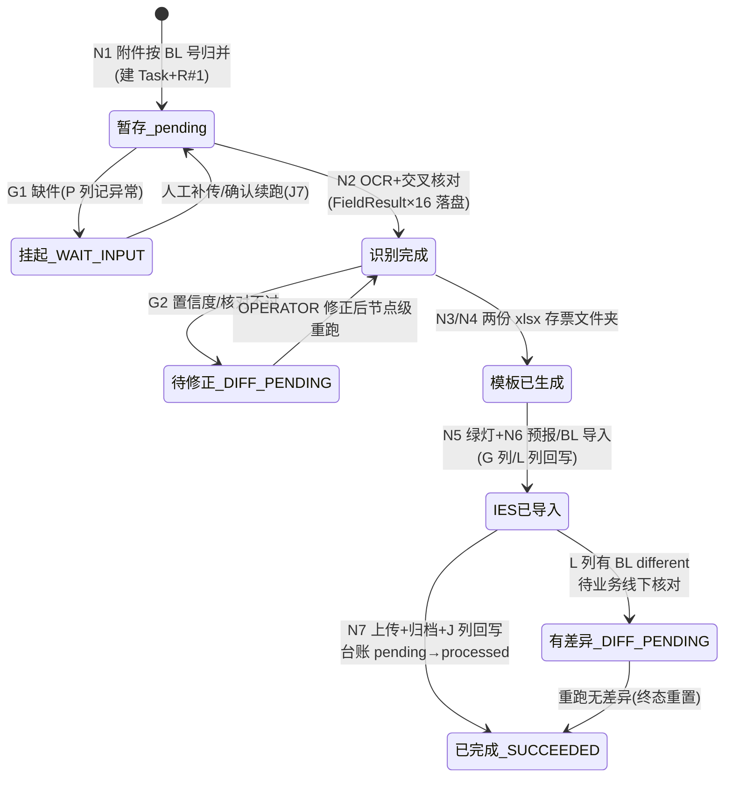

# PRD 数据字段展示方式优化

## 背景：开发反馈数据清单不足

现有 PRD 仅列数据字段清单及取值逻辑，未体现数据获取时机、先后顺序及使用场景，开发难以理解全貌。

## 建议：补充数据时序图

将数据流向融入 PRD 时序逻辑图，或单独输出泳道图/时序图，明确附件名称、发生节点及流转关系，降低沟通成本。

---

# 附：Case2-GLC 线数据流转时序图（示例产出）

> 依据 `UC34-Case2-GLC_PRD_修订版.md`（v1.3.0）整理，节点编号统一采用 7.4 节 N1~N7 口径（R6 矩阵中"节点3~7"为旧编号，对应关系见第 4 节附注）。本图回答三个问题：**数据什么时候来、按什么顺序来、来了之后给谁用**。

## 1. 数据流转总览时序图

```mermaid
sequenceDiagram
    autonumber
    participant SCH as 调度器
    participant MB as Portal 公邮
    participant PF as MBPTS 平台(N1~N7)
    participant STG as 暂存库+附件台账(平台内部存储)
    participant IES as IES+
    participant RPT as AVIS BL status report(大表)
    participant SP as 归档(SharePoint/T盘)

    SCH->>PF: T01 触发(周一 09:00,窗口=上周一至周日)【粒度=批次】
    Note over PF: N1 下载收单
    PF->>MB: 按 R-GLC 三条规则扫描(主题分类)
    MB-->>PF: 船公司(OOCL)邮件附件:AVIS PDF / Shippers_Decl / Bill of lading
    PF->>STG: 附件按 BL 号归并入库,台账=pending<br/>(平台自建账,唯一键=BL号×角色×版本);同 BL 保留最新版
    PF->>RPT: 回写 E 列(AVIS No.,来自 AVIS Shippers Ref)
    PF->>PF: 逐 BL 建 Task+R#35;1(收单即建票)【粒度:邮件→票(BL),一 BL 一票】
    Note over PF: 闸口 G1:齐套判断+DG 定版
    alt 缺件(缺 AVIS/BL,DG 缺 Shipper)
        PF->>RPT: P 列记"未找到对应 AVIS,请确认是否漏发"
        Note over PF: Run=WAIT_INPUT 挂起(Run 级状态,粒度=票/BL 号,缺几件挂几票)<br/>缺件处理区人工补传后续跑(R3.3)
    else 齐套放行
        PF->>RPT: 回写 M 列(DG 标记)
        Note over PF: N2 OCR 识别+交叉核对
        PF->>STG: 取件组装文件包(DG 含 Shipper)
        PF->>PF: OCR 产出 16 字段 FieldResult(逐字段带置信度/质量等级)<br/>(AVIS 全页+BL 全页,箱×MBZ 展开)【粒度:票→箱×MBZ 行,单票可达数十行】
        PF->>PF: AVIS⇄BL 交叉核对(箱号/封号/体积/重量)
        PF->>RPT: 回写 D 列(目的港名)/F 列(ETA)
        Note over PF: 闸口 G2:OCR 字段级置信度≥0.85(任一字段低于阈值即拦,OPEN-G23)<br/>且核对通过,否则 DIFF_PENDING 待人工修正
        Note over PF: N3/N4 写 IES 导入模板(产物 xlsx 存票文件夹)
        PF->>PF: 填 AVIS 导入模板 7 列(口径 A=AVIS PDF / 口径 B=gvShipLog,OPEN-G21)【行粒度=箱×MBZ】
        PF->>PF: 填 BL 导入模板 9 列(取自提单 (16)~(20) 区)【行粒度=箱级】
        Note over PF: N5 导入 AVIS(IES)
        PF->>IES: 查 Shipping log(gvShipLog)→查 MBZ 发票→批量导入→等绿灯
        opt DG 票(节点 5a)
            PF->>IES: invoice 级导出→算 FOB 差异→FOB 填 Others(O 列)→保存
        end
        PF->>RPT: IES 绿灯后回写 G 列=Y(AVIS 导入成功标记,非解析 PDF)
        Note over PF: N6 导入 BL(IES)
        PF->>IES: 全选发票生成预报(港口经 IES Port 表,船名航次 COPY)
        PF->>IES: BL 模板经 IES「集装箱信息」界面批量导入(模板→IES,与 N4"填模板"是两步)
        alt 差异弹窗
            IES-->>PF: 差异明细(接口值 vs 提单值)
            PF->>RPT: 回写 L 列 BL different(不阻断)
        end
        Note over PF: N7 上传+归档
        PF->>IES: 上传附件:AVIS(类别 Other)/Shipper(仅 DG)/BL,全部传完保存
        PF->>RPT: 回写 H/K/N=Y(三类上传成功标记)
        PF->>SP: 归档:&lt;归档根&gt;/&lt;PDC&gt;/GLC/&lt;运行周&gt;/票文件夹<br/>(AVIS 原件+BL PDF+Shipper(仅 DG)+两份已填模板)
        PF->>RPT: 回写 J 列 BL Creation,台账 pending→processed【粒度:收敛回票,回写一行=一票】
    end
```

**粒度链（GLC）**：批次（T01 周窗口）→ 票（N1 按 BL 归并建 Task）→ 箱×MBZ 行（N2 FieldResult、N3 AVIS 模板，单票可达数十行）→ 箱级（N4 BL 模板）→ 收敛回票（N7 上传/归档，大表回写一行=一票）；展开发生在 N2~N4（互核/模板），收敛在 N7，缺件/差异挂起均为票级。

## 2. 附件/数据载体流转表（发生节点 × 流向）

| 数据载体 | 进入节点 | 来源 | 平台内形态变化 | 最终去向 |
|---------|---------|------|--------------|---------|
| AVIS PDF（邮件附件） | N1 收单 | Portal 公邮 | 暂存库(pending) → N2 OCR 取 16 字段中大部分 → N3 填 AVIS 模板（口径 A） | N7 上传 IES（类别 Other）+归档票文件夹；台账→processed |
| Bill of lading PDF（邮件附件） | N1 收单 | Portal 公邮 | 暂存库 → N2 OCR（BL 号/航次/(16)~(20) 区）→ N4 填 BL 模板 | N7 上传 IES+归档 |
| Shippers_Decl（邮件附件，仅 DG 票） | N1 收单（命中仅登记） | Portal 公邮 | 暂存库 → G1 参与齐套/DG 定版 → N2 随文件包组装 | N7 上传 IES+归档（文件夹名加 DG 后缀） |
| gvShipLog（Shipping log 导出，16 列） | N5 查询 | IES+ | 口径 B 取数源（J/K/L/M/N 列）/口径 A 互核源；PDC/ETA/Vessel 核对（OPEN-G19） | 不归档；仅取数与勾稽 |
| 发票导出（27 列，仅 DG 票） | N5a 查询 | IES+ invoice 级导出 | 算 FOB 差异（P−I−J−L−M−N 列）→ FOB 填回顾本 O 列 Others | 在 IES 内保存，不入平台归档 |
| AVIS 导入模板（7 列 xlsx） | N3 生成 | FieldResult（口径配置） | 平台生成已填模板，存票文件夹 | N5 批量导入 IES；随票归档 |
| BL 导入模板（9 列 xlsx） | N4 生成 | 提单 OCR (16)~(20) 区 | 平台生成已填模板 | N6 导入 IES；随票归档 |
| IES 预报/台账 | N6 生成 | IES+（港口经 Port 表转换） | 差异弹窗明细捕获 | 差异明细回写大表 L 列 |

## 3. 字段级获取时机与使用场景（16 项识别字段）

> 字段编号同 PRD 8.0.1（F-08 已删除，编号保留）。值三层语义：originalValue（OCR 原值）→ correctedValue（人工修正）→ effectiveValue（后续节点一律读此值）。

| 字段 | 获取节点 | 数据来源 | 使用场景（谁用/影响什么） |
|------|---------|---------|--------------------------|
| F-01 AVIS No. | N2 OCR | AVIS "Shippers Ref" | N1 回写 E 列；归档文件夹名前段；归并辅助键 |
| F-02 Customer code | N2 OCR | AVIS "Consignee" 行右侧代码 | G1 查 PDC 对应表 → F-03 |
| F-03 PDC | G1 规则计算 | RefTable(pdc)（唯一来源） | N7 归档路径层级；未命中建 Other 不阻断 |
| F-04 BL 号（OOLU+10 位） | N1 归并 / N2 OCR | 提单 "SEA WAYBILL NO."（AVIS 同号无前缀，NORM-01 补 OOLU） | 票主键：Task 编号/暂存归并键/去重键/回写定位 |
| F-05 Port (Arrival) | N2 OCR | AVIS "Arrival"（目的港名） | N2 回写 D 列；N6 预报（经 IES Port 表转换） |
| F-06 Departure | N2 OCR | AVIS "Departure"（BL PORT OF LOADING 同值互核） | N6 预报起运港 |
| F-07 ETA | N2 OCR | AVIS "Estimated date of arrival"（DD.MM.YYYY→ISO，NORM-05） | N2 回写 F 列；归档文件夹名 ETA 段 |
| F-09 Vessel/Voyage | N2 OCR | 船名=AVIS "Flight No./Vessel Name"；航次=BL | N6 预报直接 COPY（R4.3） |
| F-10 DG 标识 | G1 定版 | 规则（Shipper 归并结果，R3.4） | 总开关：N5a 走否/M 列回写/归档 DG 后缀/Shipper 上传 |
| F-11 Container No. | N2 OCR | 口径 A=AVIS "Container-No" 去空格；口径 B=gvShipLog J 列；互核=提单 (16) 区 | N3 AVIS 模板第 3 列；N4 BL 模板第 4 列 |
| F-12 Container Type | N2 OCR | 口径 A=AVIS "Typ"；口径 B=gvShipLog K 列；BL 取 (18) 区解析（NORM-04：`"`→`'`、40HQ→40'） | AVIS 模板第 4 列；BL 模板第 5 列 |
| F-13 Seal Number | N2 OCR | 口径 A=AVIS "Seal-No"；口径 B=gvShipLog L 列；互核=提单 (16) 区 | AVIS 模板第 5 列；BL 模板第 6 列 |
| F-14 Container VOL (m³) | N2 OCR | 口径 A=AVIS 合计行体积 ÷1000（欧式小数，NORM-03）；口径 B=提单 (20) | AVIS 模板第 6 列；BL 模板第 9 列；容差互核（OPEN-G13） |
| F-15 Container Load (KG) | N2 OCR | 口径 A=AVIS 合计行重量；口径 B=提单 (19) | AVIS 模板第 7 列；BL 模板第 8 列 |
| F-16 Package Qty | N2 OCR | 提单 "NO. of PKGS.(17)"；勾稽 gvShipLog 同箱 N 列合计（R4.5） | BL 模板第 7 列 |
| F-17 MBZ（1..n） | N2 OCR | 口径 A=AVIS MBZ 列全行；口径 B=gvShipLog M 列（NORM-07 保留前导零） | N5 发票查询输入（R5.1）；AVIS 模板行粒度=箱×MBZ（单票可达数十行） |

**字段间依赖（执行顺序约束）**：F-02→F-03（PDC 派生）；F-04 为主归并键先于一切归并；F-10=Y → N5a 必走；F-11/13/14/15 互核不一致 → 停 G2 待人工，不进 N3。

## 4. 大表回写时机矩阵（列 × 节点 × 值来源）

| 列 | 内容 | 写入节点（N 口径） | 值来源 |
|----|------|------------------|--------|
| E | AVIS No. | N1 收单 | F-01 |
| M | DG 标记 | G1 闸口（N1→N2）DG 定版 | F-10 |
| D | Arrival（目的港名） | N2 OCR 完成 | F-05 |
| F | ETA | N2 OCR 完成 | F-07 |
| G | AVIS 创建成功（IES） | N5 IES 绿灯（批量导入成功）后 | 成功标记 Y（IES 操作结果，非解析 AVIS PDF） |
| L | BL different | N6 差异弹窗捕获后 | 弹窗字段级明细（接口值 vs 提单值） |
| H/K/N | 三类 PDF 上传成功=Y | N7 各类上传成功后 | 成功标记（列-文件对应 OPEN-G14，推断 H=AVIS、K=Shipper、N=BL） |
| J | BL Creation | N7 本票全部完成 | 完成标记 |
| P | 异常情况反馈 | 任意节点异常时 | 异常描述（如"未找到对应 AVIS，请确认是否漏发""未找到 xxx 发票"） |

> 附注（编号口径）：PRD R6 原文的"节点 3/4/5/6/7"对应本文 G1/N2/N5/N6/N7（7.4 节 N1~N7 为现行口径，旧编号同步仍在 OPEN 跟进）。回写语义：同 BL 同列**覆盖写**（以最新 Run 为准，R7.1）；新 Run 未再出现差异时 L 列是否清空【OPEN-G28，建议覆盖清空】。

## 5. 数据状态流转（一票数据的生命周期）



**关键时点小结**：数据获取严格按 N1（附件）→ G1（PDC/DG 派生）→ N2（16 字段 OCR）→ N3/N4（模板物化）→ N5/N6（IES 交互产生新数据：绿灯/预报/差异）→ N7（上传回写+归档落地）单向流动；人工修正只发生在 G2 停摆期间，且仅写当前生效 Run，重跑时随配置快照携带进入 R#N+1。

---

# 附：Case5 数据流转时序图（ASN 自动创建，MBPLAP / X-entry 双支线）

> 依据 `docs\Case5_PRD\UC34-Case5_PRD_修订版.md`（v2.0.0）整理。Case5 无对外系统写入（DSS/SPM 零集成），数据终点 = DSS 导入模板（9 字段）发布 Portal + 时间戳目录追加归档；票粒度：MBPLAP=分单号 HAWB、X-entry=运单号 AWB；模板命名：MBPLAP=「提单号_发票号」、X-entry=「PN_日期」。

## 1. MBPLAP 支线数据流转时序图（定时批量 12:00 / 17:00，6 节点）

```mermaid
sequenceDiagram
    autonumber
    participant SCH as 调度器(12:00/17:00 可配置)
    participant PF as MBPTS 平台(N1~N6)
    participant IES as IES+ 系统
    participant PT as Portal(模板下载)
    participant SP as SharePoint 归档

    SCH->>PF: 触发(执行当日窗口,手动批量重提交并入队列)【粒度=批次】
    Note over PF: N1 触发与预报导出
    PF->>IES: 进口预报批量导出(Supplier=MBPLAP 且 Pre-alert creation=当日)
    IES-->>PF: 数据① 预报清单 Excel(HAWB No. 列表)【粒度=批次行集】
    Note over PF: 17:00 窗口剔除 12:00 已成功运行分单号<br/>导出为空→批次台账(平台自建)记「当日无数据」,批次成功终态
    Note over PF: N2 分单号归集建票
    PF->>PF: 取 HAWB No. 列去重(同窗口+历史在途)<br/>逐分单号建 Task+R#35;1(登记即建票)【粒度:批次→票(HAWB)】
    Note over PF: N3 发票 PN 级导出
    PF->>IES: HAWB 批量粘贴查询→「PN 级别模板全部导出」
    IES-->>PF: 数据② 发票导出清单 Excel(A/M/H/AE/Z 列)【粒度:票→PN 行】
    Note over PF: 闸口 G1 数据就绪:导出非空+列结构校验<br/>(列结构变更→FAILED 转人工)
    Note over PF: N4 合并加总与模板填写
    PF->>PF: 按合并键(同发票号+同 Order No.+同 Part No.)【粒度:PN 行→合并行,多合一收敛】<br/>加总 AE 列 Qty→映射 9 字段<br/>(Order No. 缺失行记 Remark 不阻塞)
    Note over PF: 闸口 G3 模板质量:9 字段必填校验<br/>合并结果为空→记异常转人工,不臆造数量
    Note over PF: N5 模板命名发布
    PF->>PT: 数据③ DSS 导入模板「提单号_发票号.xlsx」逐票发布可下载【粒度=票级产物,一票一文件】
    Note over PF: N6 归档与台账
    PF->>SP: 归档 MBPLAP\&lt;YYYYMMDD_HHmm&gt;\(新时间戳目录,不覆盖历史)
    PF->>PF: 批次台账(平台自建)登记(总票/成功/Remark 行)→终态判定【粒度:票→批次汇总】
```

**数据流要点（MBPLAP）**：数据全部源自 IES+ 两次导出（预报清单 → 发票 PN 级清单），平台只做去重、合并加总（Qty）与 9 字段映射；无任何回写 IES/大表动作；每批次产出 = 逐票 xlsx（Portal 发布 + SharePoint 时间戳目录归档）+ 批次台账。

**粒度链（MBPLAP）**：批次（定时窗口导出）→ 票（N2 逐分单号建 Task）→ PN 行（N3 发票 PN 级清单）→ 合并行（N4 三键合并加总，多合一收敛）→ 票级产物（N5 一票一模板）→ 批次汇总（N6 批次台账）；收敛点=N4 合并键。

## 2. X-entry 支线数据流转时序图（送货邮件触发，7 节点）

```mermaid
sequenceDiagram
    autonumber
    participant M as Portal 公邮 asn@mb.cn
    participant PF as MBPTS 平台(N1~N7)
    participant DIM as 诊断仪大表(维度表)
    participant INV as 系统库(进口发票)
    participant PT as Portal(模板下载/收货查询)
    participant SP as SharePoint 归档
    participant U as IO/BU(人工)

    M->>PF: 数据① 报关代理(Fullcome)送货邮件(@bjfcl.com 且「快件签收单」,附 pod Excel)
    Note over PF: N1 邮件监听收单
    PF->>PF: 解析 AWB→附件入暂存(平台内部)→收单即建 Task+R#35;1(票=AWB)【粒度:邮件→票,1:1】<br/>数据② IMS PO 邮件按 PO 号归并登记(不建票)
    Note over PF: N2 诊断仪大表查询
    PF->>DIM: 按 AWB(N 列)筛选
    DIM-->>PF: 数据③ PN(D 列)/QTY(F 列多行加总)/ID No.(J 列)【粒度:票→PN 行,QTY 多行加总收敛为单值】
    Note over PF: 闸口 G1 数据就绪:AWB 命中且三项齐备<br/>(无匹配→FAILED 转人工,提示大表版本滞后)
    Note over PF: N3 MBPTS PO 判定
    PF->>DIM: 按 ID No. 查灰色区 M 列
    DIM-->>PF: 数据④ MBPTS PO 值
    alt PO 为空(硬阻断 R4.1)
        PF-->>U: Run=WAIT_INPUT(need=idno,票/AWB 粒度)+站内提醒
        U->>PF: 上传中心补录 ID No.(4~8 位校验,留痕)→随下次运行续跑
    end
    Note over PF: N4 PO 邮件与 Item 提取
    PF->>M: 按 PO 号搜 PO 邮件(标题/正文)
    opt PO 邮件未到
        PF->>PF: Run=WAIT_INPUT(need=po_mail)等齐续跑
    end
    PF->>PF: 数据⑤ OCR SPM 截屏取 Item Number 列(一 ITEM 一 SN 一行)【粒度:票→Item 行】
    Note over PF: N5 进口发票查询
    PF->>INV: 按 AWB 查进口发票
    INV-->>PF: 数据⑥ Our delivery note number(ASN)/Document date(Shipment Date)
    alt 发票缺失
        PF-->>U: Run=WAIT_INPUT(need=invoice)+引导补传→补传后整单重跑
    end
    Note over PF: N6 顺次收货拆行与模板填写
    PF->>PF: 多 Item→顺次收货拆行(单行不拆)【粒度:Item 行→模板行,1 拆 n】→映射 9 字段(每行一套)<br/>(Qty 勾稽异常→Remark+转人工)
    PF->>PT: 数据⑦ DSS 导入模板「PN_日期.xlsx」发布可下载
    Note over PF: 闸口 G3 模板质量:9 字段必填校验(PO Item 按规则可空)
    Note over PF: N7 发布归档与收货登记
    PF->>SP: 归档 X-entry\&lt;YYYYMMDD_HHmm&gt;\<br/>模板+进口发票原件+报关代理附件原件(保持原名)
    PF->>PT: 收货记录登记(source=rpa,按模板行)→可查询<br/>台账 pending→processed→SUCCEEDED
```

**数据流要点（X-entry）**：数据呈"四源汇聚"——送货邮件（AWB 建票）→ 诊断仪大表（PN/QTY/ID No. → PO）→ PO 邮件 SPM 截屏（Item Number 拆行依据）→ 系统库进口发票（ASN/Shipment Date）；三个人工数据补入点（H01 补录 ID No.、补传发票、H02 手工收货录入）均以 WAIT_INPUT 挂起承载，数据补齐后续跑；产出 = 逐票 xlsx + 收货记录表（自动 source=rpa，与手工记录并查）。

**粒度链（X-entry）**：邮件→票（AWB，1:1）→ PN 行（大表 QTY 多行加总收敛为单值）→ Item 行（SPM 截屏一 ITEM 一 SN）→ 模板行（N6 顺次收货 1 拆 n，单行不拆）→ 收货记录行（按模板行登记）；收敛点=N2 QTY 加总，展开点=N6 拆行。

---

# 附：Case2-MBUSI 线数据流转时序图（美线 CMA CGM，10 节点）

> 依据 `UC34-Case2-MBUSI_PRD_修订版.md`（v1.2.0）整理。与 GLC 的关键差异：数据源是 **Central Warehouse 网站导出的 gvShipLog（不是邮件 AVIS）**；建票时机 = 大表登记即建；N1/N2 为批量级节点（产物全批次共享），N3~N10 为票级；漏数票（邮件先到、大表未登记）建挂起 Task 等补登捕获。

```mermaid
sequenceDiagram
    autonumber
    participant SCH as 调度器(每周一 09:00 可配置)
    participant CW as Central Warehouse 网站
    participant PF as MBPTS 平台(N1~N10)
    participant RPT as AVIS BL status report(美线 sheet)
    participant MB as 平台公邮(CMA 转发)
    participant STG as 暂存库+附件台账(平台内部存储)
    participant IES as IES+
    participant SP as SharePoint 归档

    SCH->>PF: 触发(上周一至周日窗口)
    Note over PF: N1 下载 gvShipLog【批量级】
    PF->>CW: website_export 导出(或 file_pickup 就位读取)
    CW-->>PF: 数据① gvShipLog Excel(16 列)【粒度=批次行集】
    Note over PF: N2 筛新增+登记+拆分【批量级】
    PF->>PF: 按 O 列 created 筛上周新增+与大表防重
    PF->>RPT: 数据② 登记大表美线 sheet(D 列 booking number=BL 号)
    PF->>SP: 每票行集拆分单票 Excel「Shipping log information_&lt;BL&gt;.xlsx」【粒度:批次行集→票,按 BL 拆分】
    PF->>PF: 逐 BL 建 Task+R#35;1(登记即建票,PDC/ETA 缺失转人工不建夹)【粒度=票(BL)】
    Note over PF: N3 填 Shipping Log 基础字段(票级起跑)
    PF->>PF: 数据③ Shipping Log 导入模板 xlsx 前 5 列(取自 gvShipLog 行集,箱级展开)【行粒度=箱级】<br/>VOL/Load 留空待回填
    Note over PF: N4 下载邮件附件 + 闸口 G1 匹配
    PF->>MB: 监听「CMA CGM - 海运提单可供使用」
    MB-->>PF: 数据④ 船公司(CMA CGM)提单邮件+BL PDF 附件
    PF->>STG: 按 BL 号入暂存,台账 pending
    alt 未匹配(美表漏数)
        PF->>RPT: 异常反馈记录;建漏数挂起 Task(WAIT_INPUT,票/BL 号粒度)<br/>补登 created 更新后下轮捕获自动续跑(或详情页确认续跑)
    else 匹配成功
        PF->>PF: 下载重命名「BL_&lt;BL号&gt;.pdf」入票文件夹,台账→processed
        Note over PF: N5 OCR 识别
        PF->>PF: 数据⑤ FieldResult(集装箱明细+预报要素,箱级展开)<br/>闸口 G2:OCR 字段级置信度≥0.85(任一字段低于即拦),否则 DIFF_PENDING 待人工
        Note over PF: N6 填 BL 模板+回填 Shipping Log
        PF->>PF: 数据⑥ BL 导入模板 xlsx 9 列(取自 BL OCR)+VOL/Load 回填 Shipping Log(承接 N3,模板第二次写)<br/>(来源优先级 OPEN-M10)→两模板存票文件夹
        Note over PF: N7 导入 Shipping Log(IES)
        PF->>IES: 按 BOL 查询发票→Shipping Log 模板批量导入 IES(模板→IES,与 N3/N6 填模板是两步)
        Note over PF: 闸口 G3:绿灯=IES 校验通过方可继续,红灯 FAILED 转人工
        Note over PF: N8 生成预报(IES)
        PF->>IES: 全选发票生成预报(来源提单,港口经 IES Port 表)
        Note over PF: N9 导入 BL 模板+差异捕获(IES)
        PF->>IES: BL 模板经 IES「集装箱信息」界面批量导入(模板→IES)
        alt 差异弹窗(不阻断)
            IES-->>PF: 差异明细(IES 不生成台账)
            PF->>RPT: 回写 BL different;终态标记「有差异」
        else 无差异
            IES-->>PF: IES 台账生成成功;回写台账状态列
        end
        Note over PF: N10 上传+归档+回写
        PF->>IES: 上传 BL PDF(文件类别待定 OPEN-M14)并保存
        PF->>SP: 归档四件套:BL 导入模板 xlsx/Shipping Log 模板 xlsx/单票 Excel/BL PDF<br/>路径 &lt;PDC&gt;\MBUSI\&lt;运行周&gt;\&lt;BL No.&gt; ETA &lt;YYYY.MM.DD&gt;
        PF->>RPT: 回写完成列(附件台账 processed 时点=N4 匹配成功,口径待确认)【粒度:收敛回票】
    end
```

**数据流要点（MBUSI）**：与 GLC 的"邮件先行"相反，MBUSI 是"**大表先行**"——gvShipLog 导出登记建票（数据①②），邮件 BL PDF 后到做 G1 精确匹配；模板数据双源：Shipping Log 基础字段取网站导出、VOL/Load 与 BL 模板全部 9 列取 BL OCR（数据⑤⑥）；漏数票不删不处理，靠大表补登后的下轮捕获自愈。

**粒度链（MBUSI）**：批次（N1/N2 批量级，产物全批次共享）→ 票（N2 登记建票+行集拆单票 Excel）→ 箱级（N3/N5/N6 箱级展开填双模板）→ 收敛回票（N10 归档四件套+大表回写）；批量级节点（N1/N2）不参与整单重跑（R7.5 整单起点=N3）。

---

# 附：Case1 数据流转时序图（危险品托运清单，空运/海运双窗口，7 节点）

> 依据 `docs\Case1_PRD\Case1_危险品托运清单_PRD_修订版.md`（v2.0.0）整理。特点：数据主干是 **IES 两次导出（预报清单 + Part List）+ 配置中心四张附表（Mapping/Package Type/UN 判定/运行结果）**；Shippers_Decl 与 MSDS 为判定辅助材料，缺失不阻断（Remark 兜底）；产出 = 一票一份托运清单（上传 IES 文档资料 + 存档）+ 附表5 运行结果 + 状态邮件。

```mermaid
sequenceDiagram
    autonumber
    participant SCH as 调度器(空运每日 00:00/海运每周一 00:00)
    participant PF as MBPTS 平台(N1~N7)
    participant IES as IES+ 系统
    participant CFG as 配置中心(平台内部,Data base 附表)
    participant SP as 存档(SharePoint/T盘)
    participant SMTP as 邮件服务
    participant U as IO 同事

    SCH->>PF: 触发(N1:算窗口+并发互斥,生成 BatchId)【粒度=批次,非按票】
    Note over PF: N2 附件下载与登记
    PF->>IES: 进口预报筛选导出(空运 DGR+当天/海运 Sea+四库+上周区间)
    IES-->>PF: 数据① 预报清单【粒度:批次→票,逐行 1 拆 n 建 Task+R#35;1,窗口内去重】
    PF->>IES: 发票界面按 HAWB/BL 批量导出
    IES-->>PF: 数据② Part List(含 AN 列 UN No.)【粒度:票→零件行,一票 n 行】
    PF->>IES: 按 BL/HAWB 下载 Shippers_Decl
    alt 下载失败
        PF->>PF: 记 Remark=Not found shippers_Decl(不阻断,R3.2)
    else 成功
        IES-->>PF: 数据③ shippers_Decl_&lt;HAWB/BL&gt;.pdf
    end
    Note over PF: 闸口 G1:预报清单+Part List 齐备(Shipper 缺也放行)
    Note over PF: N3 UN 匹配初筛
    PF->>CFG: 读附表4 Transport name(UN 判定主表)
    CFG-->>PF: 数据④ UN→是否制作(Y/N/NA/SET)
    PF->>PF: 初筛剔除 N/#35;N/A(零件行级剔除,票仍留),结果写回 Part List AR 列(一行一判定)
    Note over PF: N4 OCR 识别 Shipper(18 项字段,缺 Shipper 票跳过)<br/>闸口 G2:OCR 字段级置信度≥0.85(建议值 OPEN-C6,任一字段低于即拦)<br/>否则 DIFF_PENDING 金色高亮待人工
    Note over PF: N5 托运清单写入
    PF->>CFG: 读附表1 表头 Mapping/附表3 Package Type
    CFG-->>PF: 数据⑤ 表头三键映射值(无命中→该票 FAILED)/包装类型
    opt Type2/3 需查
        PF->>IES: License→Hazmat 查 indicator/批量下载 MSDS(取第 14 章,公路运输优先)
        IES-->>PF: 数据⑥ indicator/SDS 文件
    end
    PF->>PF: 明细 Type1-4 分支(零件行级)+SET 套装逐 UN 核验【粒度:套装 1 再拆 n】<br/>→票级判定【粒度:零件行收敛→票,全票无纳入=N_ Not required】
    alt 需制作
        PF->>PF: 数据⑦ 生成「道路运输危险货物托运清单_&lt;BL/HAWB&gt;.xlsx」(一票一份;<br/>明细行=剔除后子集+套装展开,行数≠零件数)
    else 无需制作
        PF->>PF: 标记 N_ Not required(走完全链,仅不上传)
    end
    Note over PF: 闸口 G3(仅 N6):IES 上传回执
    PF->>IES: N6 上传清单至预报界面文档资料(记录 Consignment list upload=Y/N)
    IES-->>PF: 上传回执
    Note over PF: N7 存档+汇总+邮件
    PF->>SP: 数据⑧ 按 &lt;日期&gt;\&lt;BL/HAWB&gt;\ 存档四件:<br/>MSDS/Shippers_Decl/part list(含 AR 列)/完成清单
    PF->>CFG: 数据⑨ 写附表5 运行结果(9 列,一行=一票,Data base 附表)
    PF->>SP: 年度操作记录累积存档(按 12/31 截止,按年命名)
    PF->>SMTP: 按 TPL-C1-STATUS 生成状态表邮件【粒度:票行→批次汇总,一次运行一封】
    SMTP-->>U: 发送 IO 同事(收件人可配置)
```

**数据流要点（Case1）**：九类数据载体按"导出（①②③）→ 判定（④⑤⑥，配置附表+IES 补充查询）→ 产出（⑦⑧⑨）"三段流动；配置附表是数据主干的一部分（附表1 无命中直接判 FAILED、附表3 未命中留空不阻断）；两个对外动作——N6 清单上传 IES、N7 状态邮件外发——发生后整单重跑有对外后果管控；失败票须在 IES 修正源数据后经批量重提（随下次调度）或单票重跑闭环。

**粒度链（Case1）**：批次（N1 BatchId）→ 票（N2 逐行建 Task）→ 零件行（N3 初筛/N5 明细判定）→ UN 行（SET 套装再展开）→ 收敛回票（票级判定、清单一票一份）→ 批次汇总（附表5 票行+状态邮件一批一表）；粒度切换点=**N2 建票、N3 展开、N5 展开+收敛、N7 汇总**，规则最密处在 N5（行级剔除≠票级剔除、明细行数≠零件数）。

---

# 附：Case2-GLC 数据流图（DFD，依据泳道时序图整理）

> 依据 Case2-GLC 泳道时序图（调度器 / Portal 公邮 / MBPTS 平台 N1~N7 / 数据库+附件台账 / IES+ / AVIS BL status report / 归档 SharePoint）整理。与时序图互补：视角从"**时间先后**"切换为"**数据在哪加工、存到哪、流向谁**"。图例：圆角框=处理过程（P1~P7，对应 N1~N7+闸口），圆柱=数据存储（D1~D3），方框=外部实体。

## 1. 数据流图（票级主链路）

```mermaid
flowchart LR
    SCH[调度器<br/>周一 09:00 T01]
    MB[Portal 公邮]
    IES[IES+]
    RPT[AVIS BL status report<br/>大表]
    SP[SharePoint 归档]

    P1([P1 收单归并<br/>N1])
    P2([P2 齐套判断+DG 定版<br/>闸口 G1])
    P3([P3 OCR 识别+交叉核对<br/>N2 / 闸口 G2:字段级置信度≥0.85])
    P4([P4 模板填写<br/>N3/N4,IES 导入模板 xlsx])
    P5([P5 AVIS 导入<br/>N5，DG 票含 5a])
    P6([P6 BL 导入+差异捕获<br/>N6])
    P7([P7 上传+归档<br/>N7])

    D1[(D1 暂存库+附件台账<br/>平台内部存储,平台自建)]
    D2[(D2 FieldResult<br/>16 字段,逐字段带置信度)]
    D3[(D3 票文件夹<br/>IES 导入模板 xlsx×2)]

    SCH -->|触发:窗口=上周一至周日| P1
    MB -->|船公司(OOCL)邮件附件:AVIS PDF / BL PDF / Shippers_Decl| P1
    P1 -->|按 BL 号归并入库,台账=pending(唯一键=BL号×角色×版本),同 BL 留最新版| D1
    P1 -->|E 列=AVIS No.;逐 BL 建 Task+R#1| RPT

    D1 -->|取件组装文件包,DG 含 Shipper| P2
    P2 -->|缺件:P 列异常反馈,Run=WAIT_INPUT 挂起(票/BL 号粒度)待人工补传| RPT
    P2 -->|齐套:M 列=DG 标记| RPT

    D1 -->|文件包| P3
    P3 -->|16 字段 FieldResult:AVIS 全页+BL 主页,箱×MBZ 展开| D2
    P3 -->|D 列=Port / F 列=ETA| RPT

    D2 -->|effectiveValue,过 G2 后放行| P4
    P4 -->|AVIS 模板 7 列 + BL 模板 9 列| D3

    D3 -->|AVIS 导入模板| P5
    P5 -->|查 MBZ 发票→批量导入→等绿灯<br/>DG 票 5a:invoice 导出→算 FOB 差异→填 Others 保存| IES
    P5 -->|IES 绿灯后 G 列=Y(AVIS 导入成功标记,非解析 PDF)| RPT

    D3 -->|BL 导入模板| P6
    P6 -->|全选发票生成预报+BL 模板经「集装箱信息」界面批量导入| IES
    IES -->|差异弹窗:接口值 vs 提单值| P6
    P6 -->|L 列=BL different(有差异,请核查,不阻断)| RPT

    D1 -->|AVIS(类别 Other)/Shipper(仅 DG)/BL 原件| P7
    D3 -->|两份已填模板| P7
    P7 -->|三类附件上传,全部传完保存| IES
    P7 -->|H/K/N 列=Y;J 列=BL Creation=Y| RPT
    P7 -->|归档:&lt;归档根&gt;/&lt;PDC&gt;/GLC/&lt;运行周&gt;/票文件夹| SP
    P7 -->|台账 pending→processed| D1
```

## 2. 数据流清单（编号 × 内容 × 起点→终点）

| # | 数据流 | 起点 → 终点 | 说明 |
|---|--------|------------|------|
| F1 | 触发指令（周窗口） | 调度器 → P1 | 周一 09:00，窗口=上周一至周日 |
| F2 | 邮件附件（AVIS PDF / BL PDF / Shippers_Decl） | Portal 公邮 → P1 | 船公司（OOCL）来邮，按 R-GLC 三条规则扫描（主题分类） |
| F3 | 归并附件 + 台账登记 | P1 → D1 | 平台自建账（唯一键=BL号×角色×版本），按 BL 号归并，台账=pending，同 BL 保留最新版 |
| F4 | E 列回写（AVIS No.） | P1 → 大表 | 值来自 AVIS PDF "Shippers Ref"；同步逐 BL 建 Task+R#1 |
| F5 | 文件包（DG 含 Shipper） | D1 → P2/P3 | G1 齐套判断与 N2 OCR 的共同输入 |
| F6 | 缺件异常（P 列） | P2 → 大表 | 如"未找到对应 AVIS，请确认是否漏发"；Run=WAIT_INPUT 挂起（Run 级状态=票/BL 号粒度，缺几件挂几票），人工补传后续跑 |
| F7 | M 列回写（DG 标记） | P2 → 大表 | 齐套放行时回写；DG 票后续走 5a 副节点 |
| F8 | 16 字段 FieldResult | P3 → D2 | AVIS 全页+BL 主页 OCR，箱×MBZ 展开；AVIS⇄BL 交叉核对（箱号/封号/体积/重量） |
| F9 | D/F 列回写（Port / ETA） | P3 → 大表 | D=AVIS "Arrival"；F=AVIS "Estimated date of arrival" |
| F10 | IES 导入模板 xlsx×2 | P4 → D3 | AVIS 导入模板 7 列 + BL 导入模板 9 列（取自提单 (16)~(20) 区），存票文件夹，供 N5/N6 批量导入 |
| F11 | AVIS 导入交互 | P5 ⇄ IES+ | 查 AVIS "MBZ"→查 MBZ 发票→批量导入→等绿灯；DG 票 5a：invoice 级导出→算 FOB 差异→FOB 填发票 Others 字段→保存 |
| F12 | G 列回写（AVIS creation=Y） | P5 → 大表 | IES 绿灯（批量导入成功）后回写的成功标记，值来自 IES 操作结果，非解析 AVIS PDF |
| F13 | BL 导入交互 | P6 ⇄ IES+ | 全选发票生成预报（必填项来源于提单）+集装箱信息导入 BL 模板 |
| F14 | 差异明细 + L 列回写 | IES+ → P6 → 大表 | 差异弹窗（接口值 vs 提单值）捕获后写 L 列"有差异，请核查"，不阻断 |
| F15 | 三类附件上传 | P7 → IES+ | AVIS（类别 Other）/ Shipper（仅 DG）/ BL，全部传完保存 |
| F16 | H/K/N/J 列回写 | P7 → 大表 | 三类上传成功=Y；J 列 BL Creation=Y（本票全部完成） |
| F17 | 归档文件包 | P7 → SharePoint | <归档根>/<PDC>/GLC/<运行周>/票文件夹：AVIS 原件+BL PDF+Shipper（仅 DG）+两份已填模板 |
| F18 | 台账终态 | P7 → D1 | pending→processed |

## 3. 数据存储说明（D1~D3）

| 存储 | 内容 | 写入者 | 读取者 | 生命周期 |
|------|------|--------|--------|---------|
| D1 暂存库+附件台账 | 平台自建的到件登记账（唯一键=BL号×角色×版本）+ 邮件附件原件（按 BL 号归并，同 BL 留最新版） | P1（入库/pending）、P7（processed） | P2（齐套判断）、P3（OCR 取件）、P7（上传原件） | 附件级：pending→processed；附件随 N7 归档后留存 |
| D2 FieldResult（16 字段） | OCR 识别结果，三层值 original→corrected→effective | P3 | P4（模板取数，一律读 effectiveValue） | 随 Run 落盘；G2 停摆期间人工修正仅写当前生效 Run，重跑随配置快照进入 R#N+1 |
| D3 票文件夹（已填模板×2） | AVIS 导入模板（7 列 xlsx）+ BL 导入模板（9 列 xlsx） | P4 | P5（AVIS 导入）、P6（BL 导入）、P7（随票归档） | 生成→导入→归档，一票一份 |

**与时序图的对读关系**：时序图回答"什么时候发生"（N1→G1→N2→G2→N3/N4→N5→N6→N7 单向推进），本图回答"数据在哪存、被谁加工"——三个存储恰好是三道闸口的产物分界：D1 是 G1 的输入池（附件齐套），D2 是 G2 的裁判依据（识别质量），D3 是 N5/N6 的执行凭据（模板物化）；人工干预只有两个入点——G1 缺件补传（写 D1）与 G2 字段修正（写 D2），均通过挂起-续跑闭环，不破坏主链路的单向流动。

---

# 附：Case3 数据流转时序图（MBPLAP 发票和预报创建，预报邮件触发，7 节点）

> 依据 `docs\Case3_MBPLAP_PRD.docx`（v0.1，2026-10-09）整理。**消歧**：Case3 与 Case5 的"MBPLAP 支线"是同名业务线下的不同场景——Case3 是**发票+预报创建**（IES+ 批量导入 INV&DN、生成预报、回复邮件），Case5 MBPLAP 是 ASN 的 DSS 模板产出（零 IES+ 写入），勿混。票粒度=HAWB（无分单号用 MAWB）；INV&DN 导入模板为 xlsx（4 sheet：INV 表头 24 列/INV 表体 14 列/DN 表头 9 列/DN 表体 5 列）。

```mermaid
sequenceDiagram
    autonumber
    participant FW as Forwarder(@tvsscs.com)
    participant MB as NPM 邮箱(RPA 监听)
    participant PF as MBPTS 平台/RPA(N1~N7)
    participant CFG as 配置中心(平台内部:INV&DN 模板+PDC/Email Mapping List)
    participant SP as SharePoint 归档
    participant IES as IES+
    participant U as 业务人员

    FW->>MB: 数据① 预报邮件(标题含「MBPLAP Pre-alert」)<br/>附件:发票箱单 PDF/运单(PDF 或图片)/MSDS+Shipper(仅 DG)
    Note over PF: N1 捕捉邮件(规则命中即建票)
    PF->>MB: 按规则扫描(发件人后缀+标题关键词,均可配置)
    PF->>PF: 读邮件正文 4 字段(Arrival port/Terminal WH/HAWB No./DG)<br/>按 HAWB 查重→建 Task+R#35;1(票=HAWB)【粒度:邮件→票,1:1】
    opt 同 HAWB 已导入 IES+ 后收到重复/更正邮件
        PF->>PF: 不自动处理,新邮件挂原任务,转「有差异」待人工(R1.5)
    end
    Note over PF: N2 下载附件重命名并归档
    PF->>PF: 按文件名关键字识别种类+重命名:<br/>发票→&lt;发票号&gt;.pdf;分单→HAWB_&lt;分单号&gt;;SDS→MSDS_&lt;分单号&gt;;Shipper→shippers_Decl_&lt;分单号&gt;
    PF->>SP: 数据② 附件归档 &lt;操作日期 YYYYMMDD&gt;/HAWB_&lt;分单号&gt;/(平台写入)
    opt 缺发票/HAWB(缺件闸口;DG 缺 MSDS/Shipper 不阻断,运行记录记 N)
        PF-->>U: 转「待上传」(票/HAWB 粒度,任务状态=最新执行实例)+提醒
        U->>PF: 任务详情补传附件→续跑(Case3 上传中心不使用)
    end
    Note over PF: N3 OCR 识别
    PF->>PF: 数据③ 识别字段(发票箱单+运单,逐字段带置信度/原文定位)
    Note over PF: N4 填写发票导入模板+校验
    PF->>CFG: Customer NO. 查 PDC Mapping(找不到→PDC 置空报错)
    PF->>PF: 数据④ INV&DN 导入模板 xlsx 4 sheet(存票文件夹)<br/>【粒度:INV 表头=发票级(一票多发票各自成模板)/INV 表体=零件行(同 MBZ+PN 合并加总)<br/>/DN 表头=包裹级(PID)/DN 表体=包裹×零件(Qty 按重量推算)】
    opt 校验不通过(R3.4/R3.5:Invoice type 非 AB/H5;DN 表体 Qty 推算不唯一;MBZ/DN:PID 多对一)
        PF-->>U: 停 N4 不导入 IES+,转「有差异」;修正后从 N5 续跑<br/>(多对一须业务先在 IES+ 处理再重跑)
    end
    Note over PF: N5 导入发票(IES)
    PF->>IES: INV&DN 模板批量导入 IES+(模板→IES,与 N4 填模板是两步)
    IES-->>PF: Warning 原文/无 Warning=Done(发票未创建→转「失败」)
    PF->>IES: 按发票号批量上传发票 PDF(不校验结果,以执行 Log 为准)
    Note over PF: N6 创建预报(IES)
    PF->>IES: 全选本分单所有发票→生成预报→录 16 字段(运单+邮件正文)
    PF->>IES: 上传文档资料:分单(HAWB)/MSDS(Others)/Shipper(Shipper decl)
    IES-->>PF: 数据⑤ Difference(Y/N,IES 自动校验预报/发票/提单)
    opt Difference = Y(差异闸口)
        PF-->>U: 文档传完暂停不发回信,转「有差异」
        U->>PF: IES+ 核对后点「确认并发送回信」→续 N7(US-03)
    end
    Note over PF: N7 发送邮件通知+运行记录
    PF->>CFG: 按 PDC 查 Email Mapping List 取收件人
    PF->>MB: 回复原预报邮件(固定正文+本票 11 列运行记录表)
    PF->>SP: 数据⑥ 年度运行记录 &lt;年份&gt;.xlsx 追加(一张发票一行,日累积/年归档)【粒度=发票级行,HAWB 级字段每行重复】
```

**粒度链（Case3）**：邮件→票（HAWB，1:1）→ 发票（一票多发票，各自成模板）→ 零件行（INV 表体，合并加总）→ 包裹（DN 表头，PID 级）→ 包裹×零件（DN 表体，Qty 按重量推算）→ 发票级行（运行记录一张发票一行）；展开集中在 N4，是本 Case 规则最密点。

**数据流要点（Case3）**：数据单一入口=预报邮件（正文 4 字段+附件按文件名定角色），IES+ 只写不读（唯一回读=Difference 字段）；平台内部配置数据两处——PDC/Email Mapping List（INV 表头 PDC 列+回信收件人）与 INV&DN 模板版本；模板呈"N4 写、N5 用"两段式（与 GLC 同构）；三个人工入点——缺件补传（待上传）、N4 校验差异修正（有差异）、Difference=Y 确认回信（有差异），均体现为"任务转待人工+处理后续跑"；对外动作=IES 发票/预报创建+回信（重跑防重复靠 N1 查重 R1.5）；数据终点=SharePoint 票文件夹+<年份>.xlsx 年度运行记录。

---

# 附：Case4 数据流转时序图（X-entry 发票与预报创建，Fedex 诊断仪，12 节点）

> 依据 `docs\Case4_Xentry_PRD.docx`（v0.1，2026-10-13）整理。**消歧**：Case4 与 Case5 的"X-entry 支线"同名不同场景——Case4 是 Fedex 诊断仪进口的**发票+预报创建**（IES+ 导入发票信息表、生成预报、纯旧货文件准备），Case5 X-entry 是 ASN 的 DSS 模板产出。票粒度=运单主页 Hawb；发票信息表为 xlsx（4 sheet，同 INV&DN 结构）；本 Case **不发送通知邮件**，上传中心启用（原始 PDF 与发票补传）。

```mermaid
sequenceDiagram
    autonumber
    participant SCH as 调度器(12:00/20:00 可配置)
    participant MB as Portal 公邮
    participant PF as MBPTS 平台/RPA(N1~N12)
    participant CFG as 配置中心(平台内部:模板+业务大表+映射表)
    participant SP as SharePoint 归档
    participant IES as IES+
    participant TD as T 盘出口文件夹
    participant U as 业务人员

    SCH->>PF: 触发(处理上次运行后到达的命中邮件+已补传任务)
    Note over PF: N1 捕捉邮件
    PF->>MB: 按规则扫描(@fedex.com+标题关键字,可配置)
    MB-->>PF: 数据① Fedex 预报邮件+预报 PDF<br/>(图片版:运单主页+运单附页+发票)
    PF->>PF: 按 HAWB 查重→建 Task+R#35;1(票=运单主页 Hawb)【粒度:邮件→票,1:1(一邮件一 PDF 一票货一种类别)】
    opt 同 HAWB 已导入 IES+ 后收到重复/更正邮件
        PF->>PF: 不自动处理,新邮件挂原任务,转「有差异」待人工(R1.4)
    end
    Note over PF: N2 附件归档
    PF->>SP: 预报 PDF 存 &lt;运行日期 YYYYMMDD&gt;/(平台写入)
    Note over PF: N3 发票齐备校验(闸口:页类型须含运单主页+附页+发票页)
    opt 不含发票
        PF-->>U: 停 N3 转「有差异」(票/HAWB 粒度)+提醒
        U->>PF: 上传中心补传原始 PDF+发票 PDF→下一运行批次从 N3 继续
    end
    Note over PF: N4 OCR 识别+HAWB 比对
    PF->>PF: 数据② 识别字段(8.0.1,逐字段带置信度/原文定位)
    Note over PF: 闸口:主页 Hawb=附页 Master(去空格)=发票页 Hawb 之一
    opt 比对不一致
        PF-->>U: 停 N4 转「有差异」;识别错误→修正字段从此节点重跑<br/>单据非同一套→上传中心补传
    end
    Note over PF: N5 新旧货判定
    PF->>PF: 按 Order type+SN 位置定类别<br/>(新货/GLC 补货的旧货/纯旧货,一份 PDF 仅一种)
    PF->>CFG: 新货/GLC 补货:取发票 Your reference 当 Order No. 查诊断仪大表<br/>Loaner pool 列=Y 即备用机(PN 改取 Loaner Pool 专用行)
    Note over PF: N6 填写发票信息表
    PF->>CFG: 查 PN:新货/GLC 补货=Article no→PN list<br/>纯旧货=SN→诊断仪大表/追踪大表
    PF->>PF: 数据③ 发票信息表 xlsx 4 sheet(Remark 1/2 按类别取值,存票文件夹)<br/>【粒度:INV 表头=发票级/INV 表体=零件行(合并加总)/DN 表头=包裹级(PID=SN)/DN 表体=包裹×零件】
    Note over PF: N7 导入发票信息表(IES)
    PF->>IES: 发票信息表上传 IES+ 导入(模板→IES,与 N6 填表是两步;一张发票一次)
    IES-->>PF: 导入结果(发票未创建→转「失败」)
    Note over PF: N8 生成预报(IES)
    PF->>IES: 选中发票生成预报+录 16 字段(运单+发票+预报固定值表)
    Note over PF: N9 预报 Remark(IES)
    PF->>IES: 批量修改 Remark(按类别:新货/新货loaner pool/新货旧的坏了德国补发/旧货)
    Note over PF: N10 存档 PDF(IES)
    PF->>IES: 预报文档资料上传预报 PDF(文档类别=HAWB)
    opt 纯旧货(N11,其余类别跳过)
        Note over PF: N11 纯旧货文件准备
        PF->>CFG: Warranty 大表查最后一次出口运单(排除 SF 开头顺丰段)
        PF->>TD: 按 SN+运单号取原出口报关单+盖章文件×4
        PF->>PF: 数据④ 填旧机电产品进口声明(模板 docx)<br/>+Serial number 比对(发票 vs 原出口报关单)
        opt SN 不一致/无法比对(Warranty 无记录/T 盘无文件)
            PF-->>U: 停 N11 转「有差异」;识别错误→修正后从此节点重跑,其余线下核实
        end
    end
    Note over PF: N12 命名存档
    PF->>SP: PDF 以 HAWB 命名,票文件夹=SN &lt;SN&gt;_&lt;品名&gt;_&lt;新旧&gt;_&lt;HAWB&gt;<br/>(预报 PDF+发票信息表+旧货文件(仅纯旧货,不上传 IES+))
```

**粒度链（Case4）**：邮件→票（Hawb，1:1，一 PDF 一票货一种类别）→ 零件行（INV 表体，合并加总）/包裹级（DN 表头，PID=SN）/包裹×零件（DN 表体）→ 收敛回票（N12 票文件夹归档）；展开集中在 N6 填表。

**数据流要点（Case4）**：主数据源单一=Fedex 预报 PDF（图片版，全字段靠 OCR），其余数据全部来自**配置中心**（三业务大表+PN list 是数据主干的一部分，查不到 PN 即转人工修正后重跑，不臆造）；IES+ 纯写入（发票/预报/Remark/文档资料），**无 Difference 回读闸口**（与 Case3 的关键差异）；纯旧货支线引入两个额外数据源（Warranty 大表+T 盘出口文件夹），旧货文件只归档不上传 IES+；人工入点两处——上传中心补传（下一批次从 N3 继续）与字段修正从此节点重跑；无对外邮件；数据终点=SharePoint 票文件夹（SN_品名_新旧_HAWB 四段命名）。
