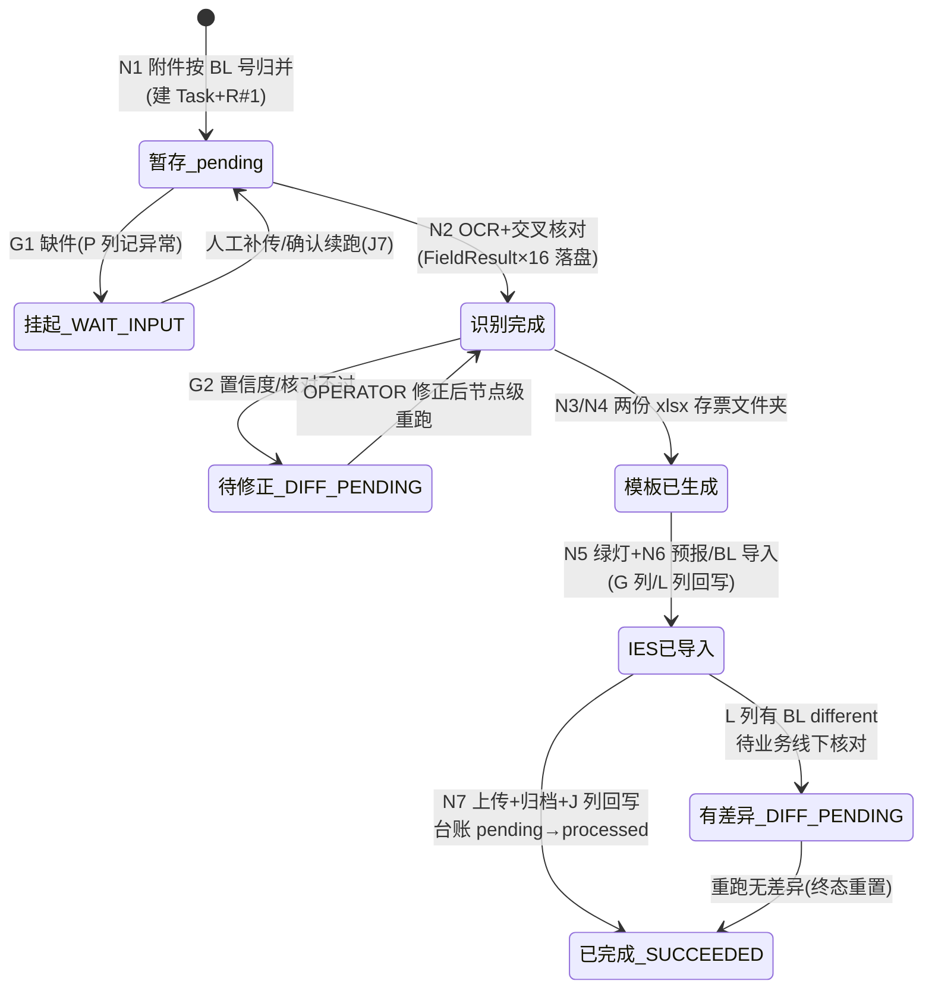

# PRD 数据字段展示方式优化

## 背景：开发反馈数据清单不足

现有 PRD 仅列数据字段清单及取值逻辑，未体现数据获取时机、先后顺序及使用场景，开发难以理解全貌。

## 建议：补充数据时序图

将数据流向融入 PRD 时序逻辑图，或单独输出泳道图/时序图，明确附件名称、发生节点及流转关系，降低沟通成本。

---

# 附：Case2-GLC 线数据流转时序图（示例产出）

> 依据 `UC34-Case2-GLC_PRD_修订版.md`（v1.3.0）整理，节点编号统一采用 7.4 节 N1~N7 口径（R6 矩阵中"节点3~7"为旧编号，对应关系见第 4 节附注）。本图回答三个问题：**数据什么时候来、按什么顺序来、来了之后给谁用**。

## 1. 数据流转总览时序图

```mermaid
sequenceDiagram
    autonumber
    participant SCH as 调度器
    participant MB as Portal 公邮
    participant PF as MBPTS 平台(N1~N7)
    participant STG as 暂存库+附件台账
    participant IES as IES+
    participant RPT as AVIS BL status report(大表)
    participant SP as 归档(SharePoint/T盘)

    SCH->>PF: T01 触发(周一 09:00,窗口=上周一至周日)
    Note over PF: N1 下载收单
    PF->>MB: 按 R-GLC 三条规则扫描(主题分类)
    MB-->>PF: 邮件附件:AVIS PDF / Shippers_Decl / Bill of lading
    PF->>STG: 附件按 BL 号归并入库,台账=pending;同 BL 保留最新版
    PF->>RPT: 回写 E 列(AVIS No.,来自 AVIS Shippers Ref)
    PF->>PF: 逐 BL 建 Task+R#1(收单即建票)
    Note over PF: 闸口 G1:齐套判断+DG 定版
    alt 缺件(缺 AVIS/BL,DG 缺 Shipper)
        PF->>RPT: P 列记"未找到对应 AVIS,请确认是否漏发"
        Note over PF: Run=WAIT_INPUT 挂起,缺件处理区人工补传后续跑
    else 齐套放行
        PF->>RPT: 回写 M 列(DG 标记)
        Note over PF: N2 OCR 识别+交叉核对
        PF->>STG: 取件组装文件包(DG 含 Shipper)
        PF->>PF: OCR 产出 16 字段 FieldResult<br/>(AVIS 全页+BL 全页,箱×MBZ 展开)
        PF->>PF: AVIS⇄BL 交叉核对(箱号/封号/体积/重量)
        PF->>RPT: 回写 D 列(目的港名)/F 列(ETA)
        Note over PF: 闸口 G2:置信度≥0.85 且核对通过<br/>否则 DIFF_PENDING 待人工修正
        Note over PF: N3/N4 写模板
        PF->>PF: 填 AVIS 模板 7 列(口径 A=AVIS PDF / 口径 B=gvShipLog,OPEN-G21)
        PF->>PF: 填 BL 模板 9 列(取自提单 (16)~(20) 区)
        Note over PF: N5 导入 AVIS(IES)
        PF->>IES: 查 Shipping log(gvShipLog)→查 MBZ 发票→批量导入→等绿灯
        opt DG 票(节点 5a)
            PF->>IES: invoice 级导出→算 FOB 差异→FOB 填 Others(O 列)→保存
        end
        PF->>RPT: 绿灯上传后回写 G 列
        Note over PF: N6 导入 BL(IES)
        PF->>IES: 全选发票生成预报(港口经 IES Port 表,船名航次 COPY)
        PF->>IES: 集装箱信息导入 BL 模板
        alt 差异弹窗
            IES-->>PF: 差异明细(接口值 vs 提单值)
            PF->>RPT: 回写 L 列 BL different(不阻断)
        end
        Note over PF: N7 上传+归档
        PF->>IES: 上传附件:AVIS(类别 Other)/Shipper(仅 DG)/BL,全部传完保存
        PF->>RPT: 回写 H/K/N=Y(三类上传成功)
        PF->>SP: 归档:&lt;归档根&gt;/&lt;PDC&gt;/GLC/&lt;运行周&gt;/票文件夹<br/>(AVIS 原件+BL PDF+Shipper(仅 DG)+两份已填模板)
        PF->>RPT: 回写 J 列 BL Creation;台账 pending→processed
    end
```

## 2. 附件/数据载体流转表（发生节点 × 流向）

| 数据载体 | 进入节点 | 来源 | 平台内形态变化 | 最终去向 |
|---------|---------|------|--------------|---------|
| AVIS PDF（邮件附件） | N1 收单 | Portal 公邮 | 暂存库(pending) → N2 OCR 取 16 字段中大部分 → N3 填 AVIS 模板（口径 A） | N7 上传 IES（类别 Other）+归档票文件夹；台账→processed |
| Bill of lading PDF（邮件附件） | N1 收单 | Portal 公邮 | 暂存库 → N2 OCR（BL 号/航次/(16)~(20) 区）→ N4 填 BL 模板 | N7 上传 IES+归档 |
| Shippers_Decl（邮件附件，仅 DG 票） | N1 收单（命中仅登记） | Portal 公邮 | 暂存库 → G1 参与齐套/DG 定版 → N2 随文件包组装 | N7 上传 IES+归档（文件夹名加 DG 后缀） |
| gvShipLog（Shipping log 导出，16 列） | N5 查询 | IES+ | 口径 B 取数源（J/K/L/M/N 列）/口径 A 互核源；PDC/ETA/Vessel 核对（OPEN-G19） | 不归档；仅取数与勾稽 |
| 发票导出（27 列，仅 DG 票） | N5a 查询 | IES+ invoice 级导出 | 算 FOB 差异（P−I−J−L−M−N 列）→ FOB 填回顾本 O 列 Others | 在 IES 内保存，不入平台归档 |
| AVIS 导入模板（7 列 xlsx） | N3 生成 | FieldResult（口径配置） | 平台生成已填模板，存票文件夹 | N5 批量导入 IES；随票归档 |
| BL 导入模板（9 列 xlsx） | N4 生成 | 提单 OCR (16)~(20) 区 | 平台生成已填模板 | N6 导入 IES；随票归档 |
| IES 预报/台账 | N6 生成 | IES+（港口经 Port 表转换） | 差异弹窗明细捕获 | 差异明细回写大表 L 列 |

## 3. 字段级获取时机与使用场景（16 项识别字段）

> 字段编号同 PRD 8.0.1（F-08 已删除，编号保留）。值三层语义：originalValue（OCR 原值）→ correctedValue（人工修正）→ effectiveValue（后续节点一律读此值）。

| 字段 | 获取节点 | 数据来源 | 使用场景（谁用/影响什么） |
|------|---------|---------|--------------------------|
| F-01 AVIS No. | N2 OCR | AVIS "Shippers Ref" | N1 回写 E 列；归档文件夹名前段；归并辅助键 |
| F-02 Customer code | N2 OCR | AVIS "Consignee" 行右侧代码 | G1 查 PDC 对应表 → F-03 |
| F-03 PDC | G1 规则计算 | RefTable(pdc)（唯一来源） | N7 归档路径层级；未命中建 Other 不阻断 |
| F-04 BL 号（OOLU+10 位） | N1 归并 / N2 OCR | 提单 "SEA WAYBILL NO."（AVIS 同号无前缀，NORM-01 补 OOLU） | 票主键：Task 编号/暂存归并键/去重键/回写定位 |
| F-05 Port (Arrival) | N2 OCR | AVIS "Arrival"（目的港名） | N2 回写 D 列；N6 预报（经 IES Port 表转换） |
| F-06 Departure | N2 OCR | AVIS "Departure"（BL PORT OF LOADING 同值互核） | N6 预报起运港 |
| F-07 ETA | N2 OCR | AVIS "Estimated date of arrival"（DD.MM.YYYY→ISO，NORM-05） | N2 回写 F 列；归档文件夹名 ETA 段 |
| F-09 Vessel/Voyage | N2 OCR | 船名=AVIS "Flight No./Vessel Name"；航次=BL | N6 预报直接 COPY（R4.3） |
| F-10 DG 标识 | G1 定版 | 规则（Shipper 归并结果，R3.4） | 总开关：N5a 走否/M 列回写/归档 DG 后缀/Shipper 上传 |
| F-11 Container No. | N2 OCR | 口径 A=AVIS "Container-No" 去空格；口径 B=gvShipLog J 列；互核=提单 (16) 区 | N3 AVIS 模板第 3 列；N4 BL 模板第 4 列 |
| F-12 Container Type | N2 OCR | 口径 A=AVIS "Typ"；口径 B=gvShipLog K 列；BL 取 (18) 区解析（NORM-04：`"`→`'`、40HQ→40'） | AVIS 模板第 4 列；BL 模板第 5 列 |
| F-13 Seal Number | N2 OCR | 口径 A=AVIS "Seal-No"；口径 B=gvShipLog L 列；互核=提单 (16) 区 | AVIS 模板第 5 列；BL 模板第 6 列 |
| F-14 Container VOL (m³) | N2 OCR | 口径 A=AVIS 合计行体积 ÷1000（欧式小数，NORM-03）；口径 B=提单 (20) | AVIS 模板第 6 列；BL 模板第 9 列；容差互核（OPEN-G13） |
| F-15 Container Load (KG) | N2 OCR | 口径 A=AVIS 合计行重量；口径 B=提单 (19) | AVIS 模板第 7 列；BL 模板第 8 列 |
| F-16 Package Qty | N2 OCR | 提单 "NO. of PKGS.(17)"；勾稽 gvShipLog 同箱 N 列合计（R4.5） | BL 模板第 7 列 |
| F-17 MBZ（1..n） | N2 OCR | 口径 A=AVIS MBZ 列全行；口径 B=gvShipLog M 列（NORM-07 保留前导零） | N5 发票查询输入（R5.1）；AVIS 模板行粒度=箱×MBZ（单票可达数十行） |

**字段间依赖（执行顺序约束）**：F-02→F-03（PDC 派生）；F-04 为主归并键先于一切归并；F-10=Y → N5a 必走；F-11/13/14/15 互核不一致 → 停 G2 待人工，不进 N3。

## 4. 大表回写时机矩阵（列 × 节点 × 值来源）

| 列 | 内容 | 写入节点（N 口径） | 值来源 |
|----|------|------------------|--------|
| E | AVIS No. | N1 收单 | F-01 |
| M | DG 标记 | G1 闸口（N1→N2）DG 定版 | F-10 |
| D | Arrival（目的港名） | N2 OCR 完成 | F-05 |
| F | ETA | N2 OCR 完成 | F-07 |
| G | AVIS 上传成功 | N5 绿灯上传后 | 成功标记 |
| L | BL different | N6 差异弹窗捕获后 | 弹窗字段级明细（接口值 vs 提单值） |
| H/K/N | 三类 PDF 上传成功=Y | N7 各类上传成功后 | 成功标记（列-文件对应 OPEN-G14，推断 H=AVIS、K=Shipper、N=BL） |
| J | BL Creation | N7 本票全部完成 | 完成标记 |
| P | 异常情况反馈 | 任意节点异常时 | 异常描述（如"未找到对应 AVIS，请确认是否漏发""未找到 xxx 发票"） |

> 附注（编号口径）：PRD R6 原文的"节点 3/4/5/6/7"对应本文 G1/N2/N5/N6/N7（7.4 节 N1~N7 为现行口径，旧编号同步仍在 OPEN 跟进）。回写语义：同 BL 同列**覆盖写**（以最新 Run 为准，R7.1）；新 Run 未再出现差异时 L 列是否清空【OPEN-G28，建议覆盖清空】。

## 5. 数据状态流转（一票数据的生命周期）



**关键时点小结**：数据获取严格按 N1（附件）→ G1（PDC/DG 派生）→ N2（16 字段 OCR）→ N3/N4（模板物化）→ N5/N6（IES 交互产生新数据：绿灯/预报/差异）→ N7（上传回写+归档落地）单向流动；人工修正只发生在 G2 停摆期间，且仅写当前生效 Run，重跑时随配置快照携带进入 R#N+1。

---

# 附：Case5 数据流转时序图（ASN 自动创建，MBPLAP / X-entry 双支线）

> 依据 `docs\Case5_PRD\UC34-Case5_PRD_修订版.md`（v2.0.0）整理。Case5 无对外系统写入（DSS/SPM 零集成），数据终点 = DSS 导入模板（9 字段）发布 Portal + 时间戳目录追加归档；票粒度：MBPLAP=分单号 HAWB、X-entry=运单号 AWB；模板命名：MBPLAP=「提单号_发票号」、X-entry=「PN_日期」。

## 1. MBPLAP 支线数据流转时序图（定时批量 12:00 / 17:00，6 节点）

```mermaid
sequenceDiagram
    autonumber
    participant SCH as 调度器(12:00/17:00 可配置)
    participant PF as MBPTS 平台(N1~N6)
    participant IES as IES+ 系统
    participant PT as Portal(模板下载)
    participant SP as SharePoint 归档

    SCH->>PF: 触发(执行当日窗口;手动批量重提交并入队列)
    Note over PF: N1 触发与预报导出
    PF->>IES: 进口预报批量导出(Supplier=MBPLAP 且 Pre-alert creation=当日)
    IES-->>PF: 数据① 预报清单 Excel(HAWB No. 列表)
    Note over PF: 17:00 窗口剔除 12:00 已成功运行分单号<br/>导出为空→台账记「当日无数据」,批次成功终态
    Note over PF: N2 分单号归集建票
    PF->>PF: 取 HAWB No. 列去重(同窗口+历史在途)<br/>逐分单号建 Task+R#35;1(登记即建票)
    Note over PF: N3 发票 PN 级导出
    PF->>IES: HAWB 批量粘贴查询→「PN 级别模板全部导出」
    IES-->>PF: 数据② 发票导出清单 Excel(A/M/H/AE/Z 列)
    Note over PF: 闸口 G1 数据就绪:导出非空+列结构校验<br/>(列结构变更→FAILED 转人工)
    Note over PF: N4 合并加总与模板填写
    PF->>PF: 按合并键(同发票号+同 Order No.+同 Part No.)<br/>加总 AE 列 Qty→映射 9 字段<br/>(Order No. 缺失行记 Remark 不阻塞)
    Note over PF: 闸口 G3 模板质量:9 字段必填校验<br/>合并结果为空→记异常转人工,不臆造数量
    Note over PF: N5 模板命名发布
    PF->>PT: 数据③ DSS 模板「提单号_发票号.xlsx」逐票发布可下载
    Note over PF: N6 归档与台账
    PF->>SP: 归档 MBPLAP\&lt;YYYYMMDD_HHmm&gt;\(新时间戳目录,不覆盖历史)
    PF->>PF: 批次台账登记(总票/成功/Remark 行)→终态判定
```

**数据流要点（MBPLAP）**：数据全部源自 IES+ 两次导出（预报清单 → 发票 PN 级清单），平台只做去重、合并加总（Qty）与 9 字段映射；无任何回写 IES/大表动作；每批次产出 = 逐票 xlsx（Portal 发布 + SharePoint 时间戳目录归档）+ 批次台账。

## 2. X-entry 支线数据流转时序图（送货邮件触发，7 节点）

```mermaid
sequenceDiagram
    autonumber
    participant M as Portal 公邮 asn@mb.cn
    participant PF as MBPTS 平台(N1~N7)
    participant DIM as 诊断仪大表(维度表)
    participant INV as 系统库(进口发票)
    participant PT as Portal(模板下载/收货查询)
    participant SP as SharePoint 归档
    participant U as IO/BU(人工)

    M->>PF: 数据① 送货邮件(@bjfcl.com 且「快件签收单」,附 pod Excel)
    Note over PF: N1 邮件监听收单
    PF->>PF: 解析 AWB→附件入暂存→收单即建 Task+R#35;1(票=AWB)<br/>数据② IMS PO 邮件按 PO 号归并登记(不建票)
    Note over PF: N2 诊断仪大表查询
    PF->>DIM: 按 AWB(N 列)筛选
    DIM-->>PF: 数据③ PN(D 列)/QTY(F 列多行加总)/ID No.(J 列)
    Note over PF: 闸口 G1 数据就绪:AWB 命中且三项齐备<br/>(无匹配→FAILED 转人工,提示大表版本滞后)
    Note over PF: N3 MBPTS PO 判定
    PF->>DIM: 按 ID No. 查灰色区 M 列
    DIM-->>PF: 数据④ MBPTS PO 值
    alt PO 为空(硬阻断 R4.1)
        PF-->>U: Run=WAIT_INPUT(need=idno)+站内提醒
        U->>PF: 上传中心补录 ID No.(4~8 位校验,留痕)→随下次运行续跑
    end
    Note over PF: N4 PO 邮件与 Item 提取
    PF->>M: 按 PO 号搜 PO 邮件(标题/正文)
    opt PO 邮件未到
        PF->>PF: Run=WAIT_INPUT(need=po_mail)等齐续跑
    end
    PF->>PF: 数据⑤ OCR SPM 截屏取 Item Number 列(一 ITEM 一 SN 一行)
    Note over PF: N5 进口发票查询
    PF->>INV: 按 AWB 查进口发票
    INV-->>PF: 数据⑥ Our delivery note number(ASN)/Document date(Shipment Date)
    alt 发票缺失
        PF-->>U: Run=WAIT_INPUT(need=invoice)+引导补传→补传后整单重跑
    end
    Note over PF: N6 顺次收货拆行与模板填写
    PF->>PF: 多 Item→顺次收货拆行(单行不拆)→映射 9 字段<br/>(Qty 勾稽异常→Remark+转人工)
    PF->>PT: 数据⑦ DSS 模板「PN_日期.xlsx」发布可下载
    Note over PF: 闸口 G3 模板质量:9 字段必填校验(PO Item 按规则可空)
    Note over PF: N7 发布归档与收货登记
    PF->>SP: 归档 X-entry\&lt;YYYYMMDD_HHmm&gt;\<br/>模板+进口发票原件+报关代理附件原件(保持原名)
    PF->>PT: 收货记录登记(source=rpa,按模板行)→可查询<br/>台账 pending→processed→SUCCEEDED
```

**数据流要点（X-entry）**：数据呈"四源汇聚"——送货邮件（AWB 建票）→ 诊断仪大表（PN/QTY/ID No. → PO）→ PO 邮件 SPM 截屏（Item Number 拆行依据）→ 系统库进口发票（ASN/Shipment Date）；三个人工数据补入点（H01 补录 ID No.、补传发票、H02 手工收货录入）均以 WAIT_INPUT 挂起承载，数据补齐后续跑；产出 = 逐票 xlsx + 收货记录表（自动 source=rpa，与手工记录并查）。

---

# 附：Case2-MBUSI 线数据流转时序图（美线 CMA CGM，10 节点）

> 依据 `UC34-Case2-MBUSI_PRD_修订版.md`（v1.2.0）整理。与 GLC 的关键差异：数据源是 **Central Warehouse 网站导出的 gvShipLog（不是邮件 AVIS）**；建票时机 = 大表登记即建；N1/N2 为批量级节点（产物全批次共享），N3~N10 为票级；漏数票（邮件先到、大表未登记）建挂起 Task 等补登捕获。

```mermaid
sequenceDiagram
    autonumber
    participant SCH as 调度器(每周一 09:00 可配置)
    participant CW as Central Warehouse 网站
    participant PF as MBPTS 平台(N1~N10)
    participant RPT as AVIS BL status report(美线 sheet)
    participant MB as 平台公邮(CMA 转发)
    participant STG as 暂存库+附件台账
    participant IES as IES+
    participant SP as SharePoint 归档

    SCH->>PF: 触发(上周一至周日窗口)
    Note over PF: N1 下载 gvShipLog【批量级】
    PF->>CW: website_export 导出(或 file_pickup 就位读取)
    CW-->>PF: 数据① gvShipLog Excel(16 列)
    Note over PF: N2 筛新增+登记+拆分【批量级】
    PF->>PF: 按 O 列 created 筛上周新增+与大表防重
    PF->>RPT: 数据② 登记大表美线 sheet(D 列 booking number=BL 号)
    PF->>SP: 每票行集拆分单票 Excel「Shipping log information_&lt;BL&gt;.xlsx」
    PF->>PF: 逐 BL 建 Task+R#35;1(登记即建票;PDC/ETA 缺失转人工不建夹)
    Note over PF: N3 填 Shipping Log 基础字段(票级起跑)
    PF->>PF: 数据③ Shipping Log 模板前 5 列(取自 gvShipLog 行集,箱级展开)<br/>VOL/Load 留空待回填
    Note over PF: N4 下载邮件附件 + 闸口 G1 匹配
    PF->>MB: 监听「CMA CGM - 海运提单可供使用」
    MB-->>PF: 数据④ 提单邮件+BL PDF 附件
    PF->>STG: 按 BL 号入暂存,台账 pending
    alt 未匹配(美表漏数)
        PF->>RPT: 异常反馈记录;建漏数挂起 Task(WAIT_INPUT)<br/>补登 created 更新后下轮捕获自动续跑(或详情页确认续跑)
    else 匹配成功
        PF->>PF: 下载重命名「BL_&lt;BL号&gt;.pdf」入票文件夹,台账→processed
        Note over PF: N5 OCR 识别
        PF->>PF: 数据⑤ FieldResult(集装箱明细+预报要素,箱级展开)<br/>闸口 G2:置信度≥0.85,否则 DIFF_PENDING 待人工
        Note over PF: N6 填 BL 模板+回填 Shipping Log
        PF->>PF: 数据⑥ BL 模板 9 列(取自 BL OCR)+VOL/Load 回填 Shipping Log<br/>(来源优先级 OPEN-M10)→两模板存票文件夹
        Note over PF: N7 导入 Shipping Log(IES)
        PF->>IES: 按 BOL 查询发票→批量导入 Shipping Log
        Note over PF: 闸口 G3:绿灯后方可上传,红灯 FAILED 转人工
        Note over PF: N8 生成预报(IES)
        PF->>IES: 全选发票生成预报(来源提单,港口经 IES Port 表)
        Note over PF: N9 导入 BL 模板+差异捕获(IES)
        PF->>IES: 集装箱信息导入 BL 模板
        alt 差异弹窗(不阻断)
            IES-->>PF: 差异明细(IES 不生成台账)
            PF->>RPT: 回写 BL different;终态标记「有差异」
        else 无差异
            IES-->>PF: 生成台账成功;回写台账状态列
        end
        Note over PF: N10 上传+归档+回写
        PF->>IES: 上传 BL PDF(类别 OPEN-M14)并保存
        PF->>SP: 归档四件套:BL 模板/Shipping Log/单票 Excel/BL PDF<br/>路径 &lt;PDC&gt;\MBUSI\&lt;运行周&gt;\&lt;BL No.&gt; ETA &lt;YYYY.MM.DD&gt;
        PF->>RPT: 回写完成列;台账 pending→processed
    end
```

**数据流要点（MBUSI）**：与 GLC 的"邮件先行"相反，MBUSI 是"**大表先行**"——gvShipLog 导出登记建票（数据①②），邮件 BL PDF 后到做 G1 精确匹配；模板数据双源：Shipping Log 基础字段取网站导出、VOL/Load 与 BL 模板全部 9 列取 BL OCR（数据⑤⑥）；漏数票不删不处理，靠大表补登后的下轮捕获自愈。

---

# 附：Case1 数据流转时序图（危险品托运清单，空运/海运双窗口，7 节点）

> 依据 `docs\Case1_PRD\Case1_危险品托运清单_PRD_修订版.md`（v2.0.0）整理。特点：数据主干是 **IES 两次导出（预报清单 + Part List）+ 配置中心四张附表（Mapping/Package Type/UN 判定/运行结果）**；Shippers_Decl 与 MSDS 为判定辅助材料，缺失不阻断（Remark 兜底）；产出 = 一票一份托运清单（上传 IES 文档资料 + 存档）+ 附表5 运行结果 + 状态邮件。

```mermaid
sequenceDiagram
    autonumber
    participant SCH as 调度器(空运每日 00:00/海运每周一 00:00)
    participant PF as MBPTS 平台(N1~N7)
    participant IES as IES+ 系统
    participant CFG as 配置中心(Data base 附表)
    participant SP as 存档(SharePoint/T盘)
    participant SMTP as 邮件服务
    participant U as IO 同事

    SCH->>PF: 触发(N1:算窗口+并发互斥,生成 BatchId)
    Note over PF: N2 附件下载与登记
    PF->>IES: 进口预报筛选导出(空运 DGR+当天/海运 Sea+四库+上周区间)
    IES-->>PF: 数据① 预报清单(逐 HAWB/BL 建 Task+R#35;1,窗口内去重)
    PF->>IES: 发票界面按 HAWB/BL 批量导出
    IES-->>PF: 数据② Part List(含 AN 列 UN No.)
    PF->>IES: 按 BL/HAWB 下载 Shippers_Decl
    alt 下载失败
        PF->>PF: 记 Remark=Not found shippers_Decl(不阻断,R3.2)
    else 成功
        IES-->>PF: 数据③ shippers_Decl_&lt;HAWB/BL&gt;.pdf
    end
    Note over PF: 闸口 G1:预报清单+Part List 齐备(Shipper 缺也放行)
    Note over PF: N3 UN 匹配初筛
    PF->>CFG: 读附表4 Transport name(UN 判定主表)
    CFG-->>PF: 数据④ UN→是否制作(Y/N/NA/SET)
    PF->>PF: 初筛剔除 N/#35;N/A(仍参与票级汇总),结果写回 Part List AR 列
    Note over PF: N4 OCR 识别 Shipper(18 项字段,缺 Shipper 票跳过)<br/>闸口 G2:置信度≥0.85,否则 DIFF_PENDING 金色高亮待人工
    Note over PF: N5 托运清单写入
    PF->>CFG: 读附表1 表头 Mapping/附表3 Package Type
    CFG-->>PF: 数据⑤ 表头三键映射值(无命中→该票 FAILED)/包装类型
    opt Type2/3 需查
        PF->>IES: License→Hazmat 查 indicator/批量下载 MSDS(取第 14 章,公路运输优先)
        IES-->>PF: 数据⑥ indicator/SDS 文件
    end
    PF->>PF: 明细 Type1-4 分支+SET 套装逐 UN 核验→票级判定
    alt 需制作
        PF->>PF: 数据⑦ 生成「道路运输危险货物托运清单_&lt;BL/HAWB&gt;.xlsx」(一票一份)
    else 无需制作
        PF->>PF: 标记 N_ Not required(走完全链,仅不上传)
    end
    Note over PF: 闸口 G3(仅 N6):IES 上传回执
    PF->>IES: N6 上传清单至预报界面文档资料(记录 Consignment list upload=Y/N)
    IES-->>PF: 上传回执
    Note over PF: N7 存档+汇总+邮件
    PF->>SP: 数据⑧ 按 &lt;日期&gt;\&lt;BL/HAWB&gt;\ 存档四件:<br/>MSDS/Shippers_Decl/part list(含 AR 列)/完成清单
    PF->>CFG: 数据⑨ 写附表5 运行结果(9 列)+年度操作记录
    PF->>SMTP: 按 TPL-C1-STATUS 生成状态表邮件
    SMTP-->>U: 发送 IO 同事(收件人可配置)
```

**数据流要点（Case1）**：九类数据载体按"导出（①②③）→ 判定（④⑤⑥，配置附表+IES 补充查询）→ 产出（⑦⑧⑨）"三段流动；配置附表是数据主干的一部分（附表1 无命中直接判 FAILED、附表3 未命中留空不阻断）；两个对外动作——N6 清单上传 IES、N7 状态邮件外发——发生后整单重跑有对外后果管控；失败票须在 IES 修正源数据后经批量重提（随下次调度）或单票重跑闭环。
