# UC34 进口单证自动化平台 · Case1~5 时序图汇总

> 版本 v1.0 · 2026-10-16
> 用途：K44/K45 PRD 第六章「业务流程图与时序图」素材底稿，供周一交付前修订使用。
> 素材来源：`docs\Case1_PRD\Case1_危险品托运清单_PRD_修订版.md`（v2.0.0）、`docs\Case2_PRD\UC34-Case2-GLC_PRD_修订版.md`（v1.2.4）、`docs\Case2_PRD\UC34-Case2-MBUSI_PRD_修订版.md`（v1.2.0）、`docs\Case2_PRD\PRD数据字段展示方式优化建议.md`（Case3/Case4 附录图）、`docs\Case5_PRD\UC34-Case5_PRD_修订版.md`（v2.0.0）、`c:\MBPTS\case全权限版本demo\`（开发侧全权限原型）。

---

## 0. 本版修改口径（相对各 PRD 现版图）

**A. 依据 2026-10-16 会议（K44/K45 分工）决议调整：**

1. **Case2 拆分为 4 个 case**：GLC、MBUSI 各新增 1 个"反向核对"平行 case。原因：正向 case 以"收邮件"为起点，识别不到"大表/BL 早已存在、对向邮件未收"的漏收场景。两个平行 case 之间**无触发关系、无数据依赖**，是两套独立逻辑（本文档分画两张图；如需合画一张，上下两段串联即可）。
2. **Case3 新增人工修正环节**：发票导入模板出现 package number（PID）对 delivery number 一对多时，IES 不允许导入 → 业务下载平台生成的模板 → 手工修正为一对一 → 上传修正模板 → 从「导入发票」节点续跑。
3. **"暂存库"表述更正**：会议明确"根本就不是暂存库"，本文档统一改为"**附件台账（平台内部存储）**"；各 PRD 业务流程图同步待改（新月跟进）。
4. Case4 尚未与开发讨论，本期仅按 demo 校对触发口径，业务逻辑不动；Case5 批量重跑/批量下载/任务内重跑不涉及时序变化，图保持原样。

**B. 依据 `case全权限版本demo` 核对调整：**

5. 触发方式一览按 demo 口径校准（§1），其中 **Case4 由"定时扫描命中邮件"改为"邮件触发建票 + 12:00/20:00 批次执行"**（demo 规则 `R-C4-FEDEX`，BRD 半天时效）。
6. Case3 修正续跑交互按 demo「**上传修正模板 · 续跑确认**」实现口径绘制（`case3.js`：N1~N4 沿用前序结果、模板替换为上传文件、从「导入发票」续跑、修正模板存入票归档文件夹、旧 Run 只读）。
7. 通用能力以 demo 为准：任务中心**批量重跑**（逐票生成新执行实例，执行中自动跳过）与**批量下载**（原始文件+节点产出打包 zip）；任务详情**整单重跑 / 自节点续跑**；上传为**任务级弹窗**（无独立上传中心页面）；异常走站内提醒（提醒中心）+ 详情页 banner。

---

## 1. 总览：触发方式 × 起点 × 节点 × 对外动作

| Case | 支线 | 触发方式（demo 口径） | 任务起点 | 节点链 | 对外动作 |
|---|---|---|---|---|---|
| Case1 危险品托运清单 | 空运 / 海运 | 定时调度（空运每日 00:00 / 海运每周一，支持手动触发） | IES 预报导出登记即建票 | N1~N7 | ①清单上传 IES ②状态邮件外发 |
| Case2-GLC 正向 | 欧线 OOCL | 定时调度（周一 09:00，上周一~周日窗口） | 扫描公邮三类邮件（AVIS/Shipper/BL），AVIS 建票、轮询 BL | N1~N7 | IES 导入/上传 + 大表回写 |
| Case2-GLC-R 反向核对（新增） | 欧线 | 定时调度（每日，可配置） | BL 邮件（关键字 bill of lading）反查 AVIS | 轻量核对链（无 IES 交互） | 差异清单（大表异常反馈） |
| Case2-MBUSI 正向 | 美线 CMA CGM | 定时调度（周一 09:00）/ BL 邮件收单 | 收 BL 邮件 → 匹美国大表（起点口径待确认，见 §8-1） | N1~N10 | IES 导入/上传 + 大表回写 |
| Case2-MBUSI-R 反向核对（新增） | 美线 | 定时调度（每日，可配置） | 下载 gvShipLog 美国大表 → 反查邮件 BL 号 | 轻量核对链（无 IES 交互） | 差异清单（大表异常反馈） |
| Case3 MBPLAP 发票与预报 | — | 邮件触发（R-C3-PREALERT：@tvsscs.com + MBPLAP Pre-alert） | 预报邮件收单即建票（票=HAWB） | N1~N7 | IES 发票/预报创建 + 回复邮件 |
| Case4 X-entry 发票与预报 | — | 邮件触发建票（R-C4-FEDEX：@fedex.com + 提单自报催办通知），12:00/20:00 批次执行 | Fedex 预报邮件（票=HAWB） | N1~N12 | IES 导入/预报（无通知邮件） |
| Case5 ASN | MBPLAP | 定时调度（12:00/17:00，17:00 剔除 12:00 已成功票） | IES 预报导出登记即建票 | N1~N6 | 无对外写入（产出 DSS 模板） |
| Case5 ASN | X-entry | 邮件触发（送货邮件） | 收单即建票（票=AWB） | N1~N7 | 无对外写入（产出 DSS 模板） |

> 触发归组（demo 任务中心口径）：定时/邮件 = 自动触发；手动新建/人工上传/重跑 = 人工触发。

---

## 2. Case1 · 危险品托运清单（空运/海运双窗口，7 节点）

> 依据 Case1 PRD 修订版 v2.0.0 §6.2，与 demo 核对无变化（定时调度口径一致）。

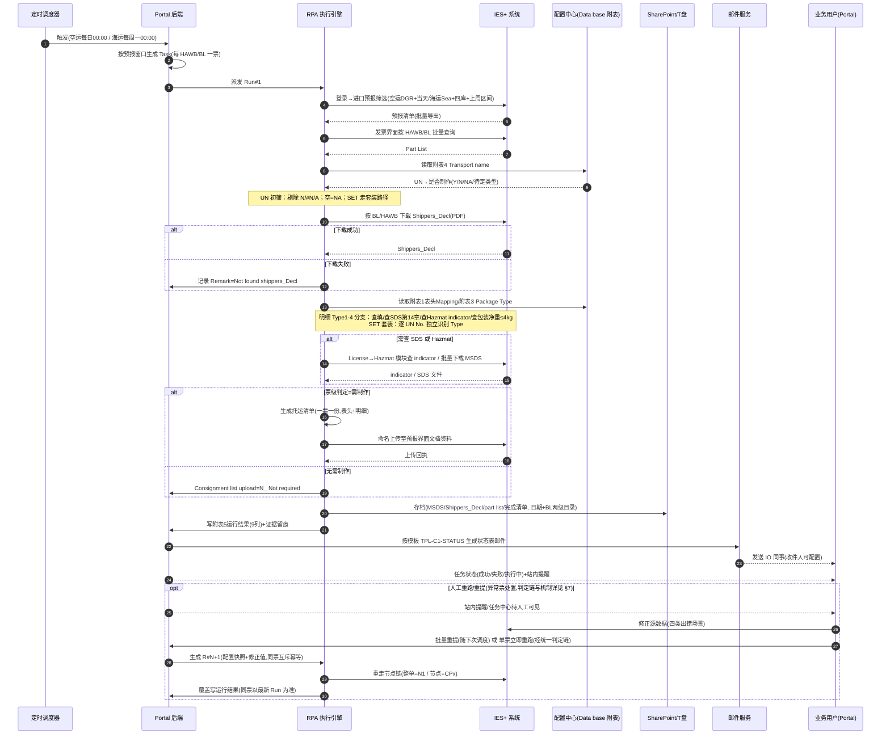

---

## 3. Case2 · AVIS / MBUSI 与 BL（2026-10-16 起 = 4 个 case）

### 3.0 结构说明

- 正向 case（§3.1 / §3.3）：以"**收邮件**"为起点完成业务主流程（填模板 → IES 导入 → 归档回写）。固有盲区：对向数据（大表记录 / BL 邮件）早已存在、但本向邮件未收到的票**拉不出来**。
- 反向核对 case（§3.2 / §3.4，**本期新增**）：以对向数据为起点反向比对，把正向 case 拿不到的漏收信息拉成差异清单，供业务跟进。
- 正/反两个 case **互不触发、互不依赖**，各自独立调度、独立建票；合在一个 PRD 内描述（业务目的相同），时序图分画。

### 3.1 Case2-GLC 正向（欧线 OOCL，7 节点）

> 依据 GLC PRD 修订版 v1.2.4 §6.2；按会议决议将"暂存库"更正为"附件台账（平台内部存储）"。

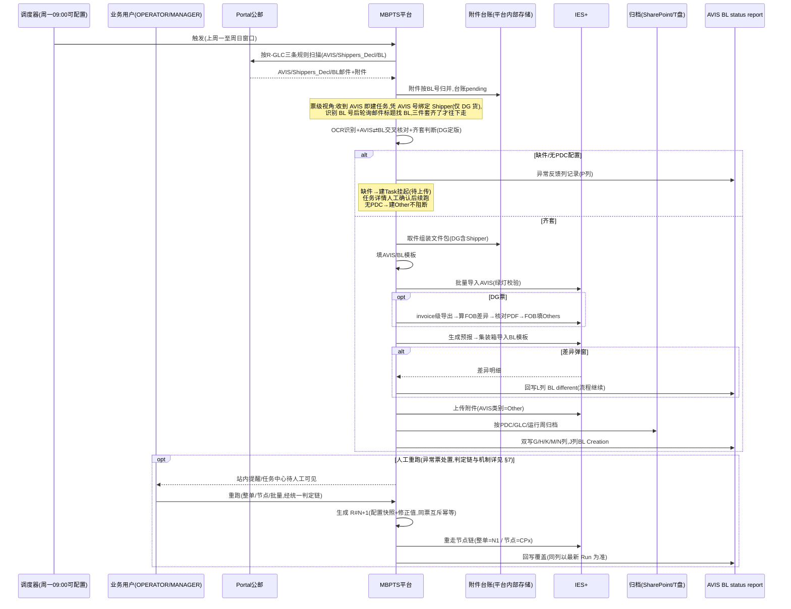

### 3.2 Case2-GLC-R 反向核对（新增平行 case，每日）

> 2026-10-16 会议新增。覆盖正向盲区：**BL 邮件早已收到、AVIS 未收到**的票。与 §3.1 无任何触发/数据关联。

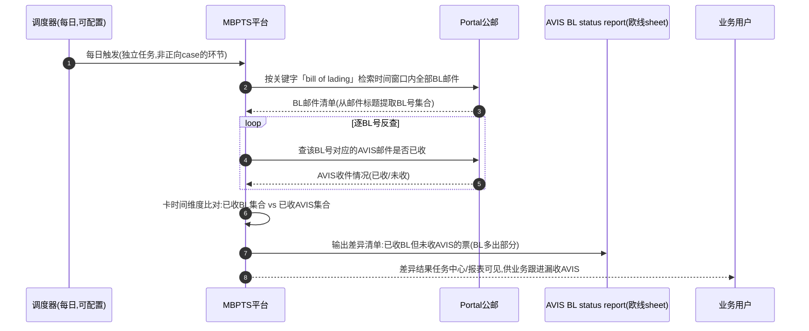

### 3.3 Case2-MBUSI 正向（美线 CMA CGM，10 节点）

> **起点口径已按 2026-10-16 会议调整**：以收到 BL 邮件为出发点，凭 BL 号匹配美国大表后继续往下走。与 v1.2.0"大表先行、登记即建"口径存在差异，见 §8-1 待确认。

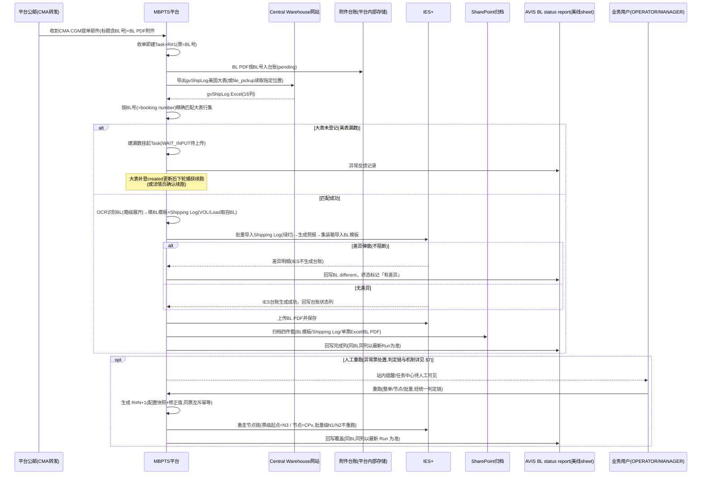

### 3.4 Case2-MBUSI-R 反向核对（新增平行 case，每日）

> 2026-10-16 会议新增。覆盖正向盲区：**美国大表早已登记、BL PDF 邮件未收到**的票。以"下载美国大表"为任务起点，与 §3.3 无任何触发/数据关联。

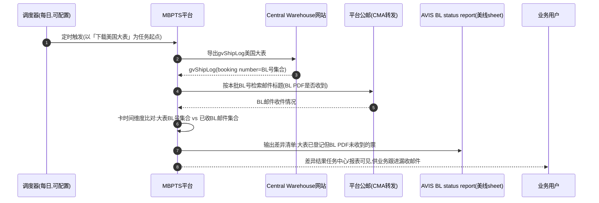

---

## 4. Case3 · MBPLAP 发票和预报创建（预报邮件触发，7 节点）

> 依据 Case3 节点链（`PRD数据字段展示方式优化建议.md` 附录）按**系统交互视角**改写（参与者=系统/角色，去除数据流转标注）：
> ① N4 校验不通过分支按 2026-10-16 会议 + demo「上传修正模板 · 续跑确认」补充**下载模板→手工一对一修正→上传→续跑**闭环；
> ② "MBZ/DN:PID 多对一"更正为会议口径"**PID 对 DN 一对多**（IES 不允许，须改一对一）"。
> 消歧：Case3 与 Case5-MBPLAP 支线同名不同场景（Case3=发票+预报创建且写 IES；Case5=ASN DSS 模板产出、零 IES 写入）。

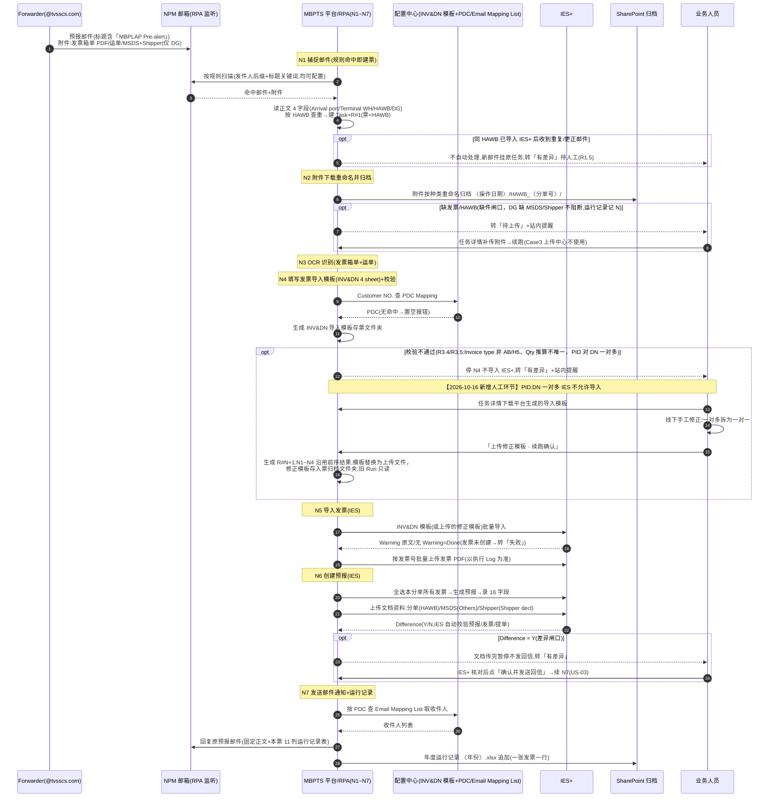

---

## 5. Case4 · X-entry 发票与预报创建（Fedex 诊断仪，12 节点）

> 依据 Case4 节点链（`PRD数据字段展示方式优化建议.md` 附录）按**系统交互视角**改写（去除数据流转标注），并修改：**触发口径按 demo 改为"邮件触发建票 + 12:00/20:00 批次执行"**（规则 R-C4-FEDEX；BRD 半天时效；原图为"调度器扫描命中邮件"）。其余业务逻辑未动（Case4 尚未与开发讨论，2026-10-16 会议明确本期不改）。
> 消歧：Case4 与 Case5-X-entry 支线同名不同场景（Case4=发票+预报创建且写 IES；Case5=ASN DSS 模板产出）。

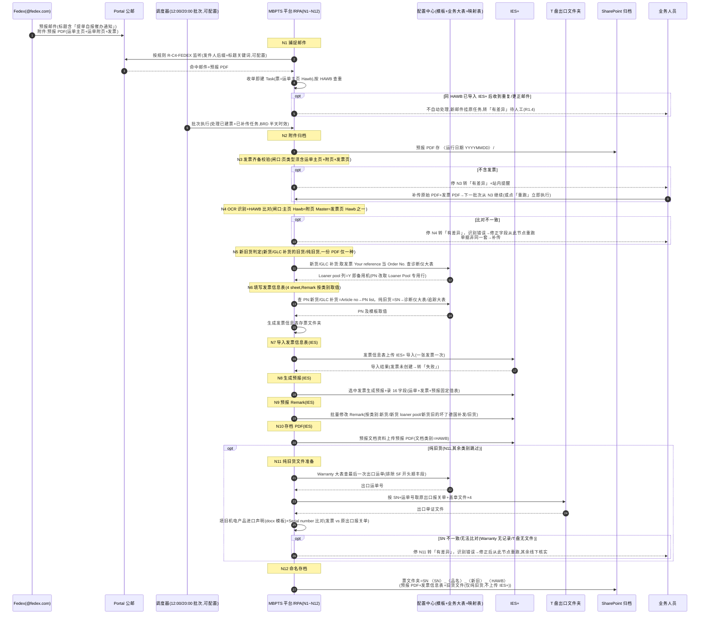

---

## 6. Case5 · ASN 自动创建（双支线，零 IES 写入）

> 依据 Case5 PRD 修订版 v2.0.0 §6.2。2026-10-16 会议确认 Case5（批量重跑/批量下载/任务内重跑）不涉及时序变化，图保持原样；与 demo 核对触发口径一致（MBPLAP 定时 / X-entry 邮件）。

### 6.1 MBPLAP 定时支线（6 节点）

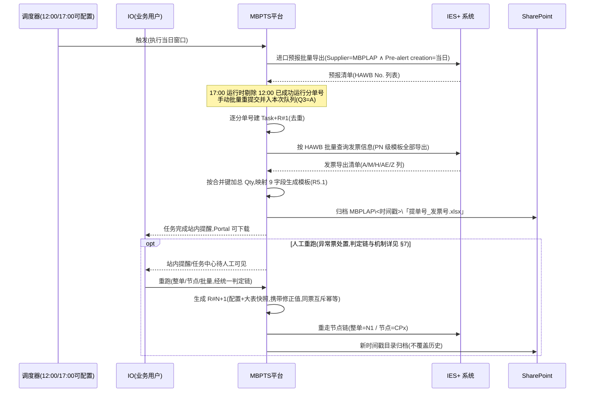

### 6.2 X-entry 邮件支线（7 节点）

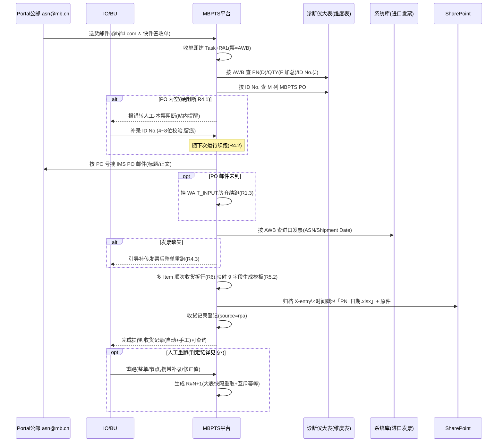

---

## 7. 通用：重跑判定链与交互时序（全 Case 共用）

> 三个重跑入口（任务详情「整单重跑」/「检查点续跑」、任务中心「批量重跑」）**统一走同一条判定链**；前端按判定链控制按钮显隐，后端提交时复核。判定链以 GLC 版本为基准，各 Case 差异见 §7.3。

### 7.1 判定流程

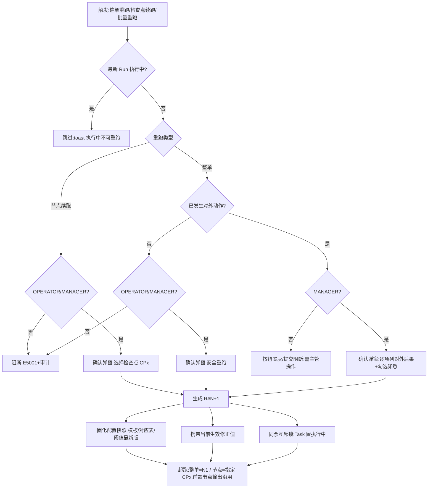

### 7.2 时序图

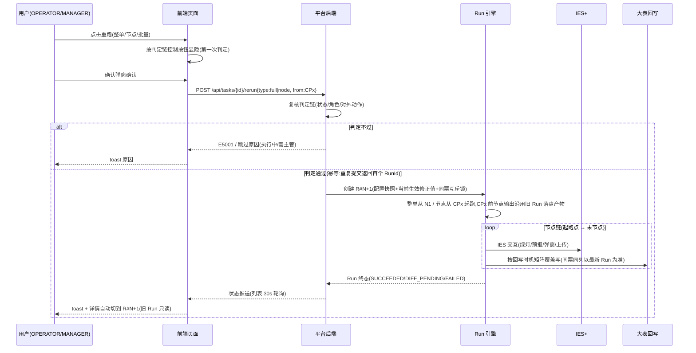

### 7.3 各 Case 差异

| Case | 第三入口 | 对外动作门槛 | 起跑点 | 特殊机制 |
|---|---|---|---|---|
| Case1 | **批量重提**（不立即执行，登记后随下次同运输方式调度，与窗口票按分单号去重 OPEN-C8） | 有（清单上传 IES/状态邮件 → 需 MANAGER） | 整单=N1 | 失败票须先在 IES 修正源数据 |
| Case2-GLC | 批量重跑（逐票立即执行） | 有（IES 导入/上传） | 整单=N1 | L 列覆盖清空待确认 OPEN-G28 |
| Case2-MBUSI | 批量重跑 | 有 | **整单=N3**（批量级 N1/N2 产物全批次共享，不重跑） | OPEN-M21 同 GLC |
| Case2-GLC-R / MBUSI-R | 不适用（核对链无 IES 交互，失败随下次每日调度自愈） | 无 | — | 本期新增，细则待定 §8-4 |
| Case3 | 批量重跑 + **「上传修正模板续跑」特有入口** | 有（IES 发票/预报+回信） | 整单=N1；修正续跑=**从 N5 起跑**，N1~N4 沿用 | 重复邮件挂原任务不自动处理（R1.5） |
| Case4 | 补传后随下一批次（12:00/20:00）继续，或立即重跑 | 有（IES 导入/预报；无通知邮件） | 整单=N1 | 纯旧货支线 N11 可独立节点重跑 |
| Case5 | 批量重跑 | **无**（零 IES 写入，判定链无"对外后果"分支 OPEN-A13） | 整单=N1 | 归档写新时间戳目录不覆盖历史（OPEN-A15） |

---

## 8. 与 demo 核对的差异 / 待确认清单

| # | 事项 | 三方口径 | 状态 |
|---|---|---|---|
| 8-1 | **Case2-MBUSI 正向起点** | 2026-10-16 会议=收 BL 邮件为起点（收单即建）；v1.2.0 PRD=大表先行（登记即建）；demo=定时调度、大表下载为流程内节点 | **待确认**，确认后回写 MBUSI PRD 并同步本图 |
| 8-2 | 「暂存库」表述 | 会议明确"根本不是暂存库"；本文档已统一改为"附件台账（平台内部存储）" | 本文档已改；各 PRD 业务流程图待新月同步 |
| 8-3 | 上传中心形态 | demo 无独立上传中心页面，上传=任务级弹窗（场景：C12 CCC 信息提取/C13 关务报表/C06 ASN 结果回传）；Case4/Case5 PRD 按"上传中心"页面描述 | 待确认（页面 or 弹窗），影响 J 系列跳转表 |
| 8-4 | 反向核对 case 细则 | 会议只定了起点与比对逻辑；差异清单的落点（大表新增列/独立报表/任务中心可见性）、调度具体时点、是否建 Task 均未细化 | 待与开发确认 |
| 8-5 | Case4 触发 | demo=邮件触发建票+12:00/20:00 批次执行；原时序图=调度器扫描命中邮件 | 本文档已按 demo 改；Case4 整体待与开发讨论后再定稿 |

---

## 附：来源文件对照

| 图 | 来源 | 本版改动 |
|---|---|---|
| §2 Case1 | `Case1_危险品托运清单_PRD_修订版.md` v2.0.0 §6.2 | 无 |
| §3.1 GLC 正向 | `UC34-Case2-GLC_PRD_修订版.md` v1.2.4 §6.2 | 暂存库→附件台账；补票级视角注释 |
| §3.2 GLC-R | 2026-10-16 会议口述 | **新增** |
| §3.3 MBUSI 正向 | `UC34-Case2-MBUSI_PRD_修订版.md` v1.2.0 §6.2 | **起点改为邮件先行**（待确认 §8-1）；暂存库→附件台账 |
| §3.4 MBUSI-R | 2026-10-16 会议口述 | **新增** |
| §4 Case3 | `PRD数据字段展示方式优化建议.md` 附录 | **新增人工修正环节**（会议+demo）；多对一→一对多更正；改写为系统交互视角 |
| §5 Case4 | `PRD数据字段展示方式优化建议.md` 附录 | 触发口径按 demo 改为邮件触发建票+批次执行；改写为系统交互视角 |
| §6 Case5 | `UC34-Case5_PRD_修订版.md` v2.0.0 §6.2 | 无 |
| §7 通用重跑 | GLC v1.2.4 §6.2.1 为基准 | 泛化为通用版+各 Case 差异表 |
